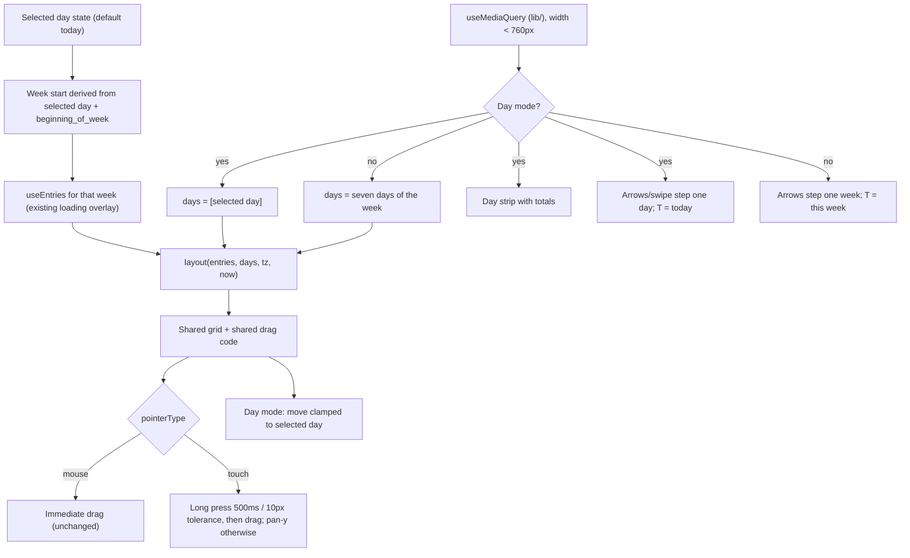
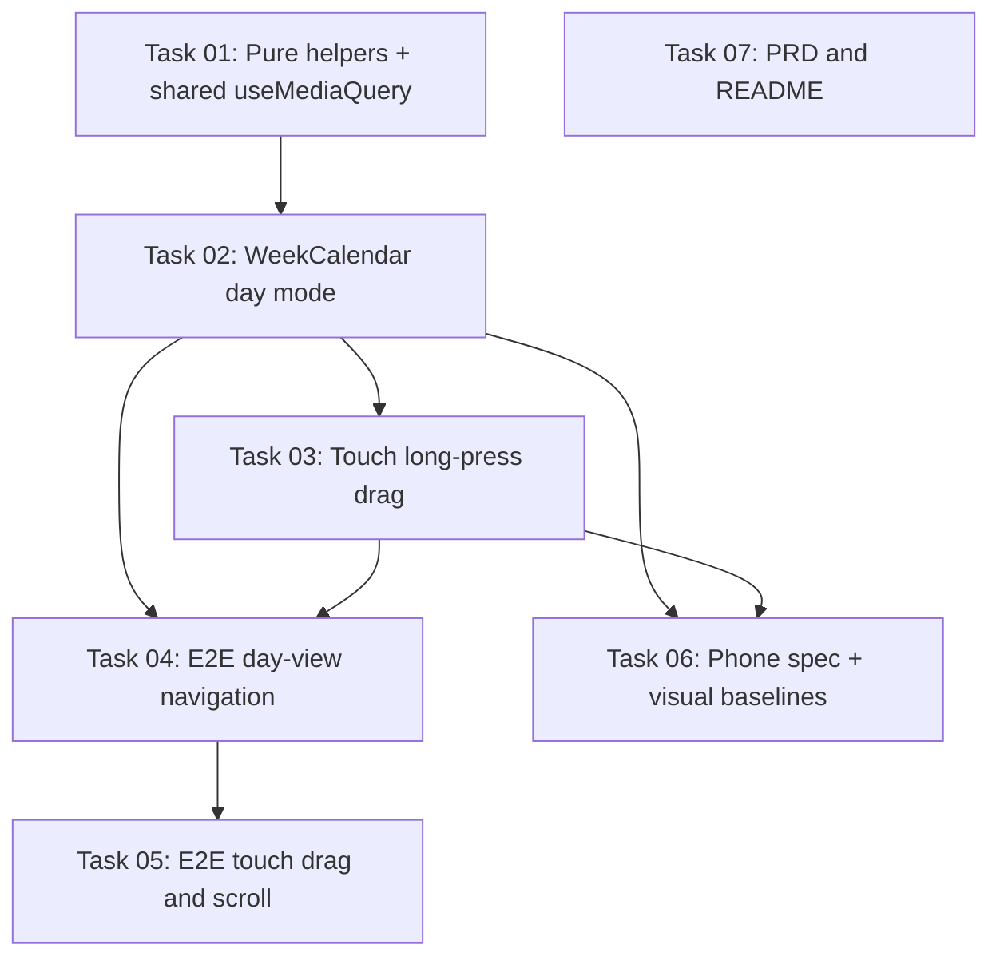

# Plan: Phone day view for the web calendar

## Original Work Order

> Work order for GitHub issue #19 "Add a day view to the web calendar on narrow screens" (https://github.com/e0ipso/tokkl/issues/19).
>
> OBJECTIVE
> On viewports narrower than 760px, the web `WeekCalendar` shows one day at a time (today selected by default) with a strip of the current week's seven days and their totals above the grid, day-by-day navigation (swipe, toolbar arrows, crossing week boundaries), per-mode `T` shortcut, and touch editing that does not block vertical scrolling. At 760px and wider, the existing week view is unchanged. This brings the PWA in line with tokkl-android PRD K1 (portrait day view) and K2 (long-press then drag, in both day and week view).
>
> SCOPE — IN
> - `packages/web/src/components/WeekCalendar.tsx` (the only calendar component; used once at `pages/TimerPage.tsx:133`): add day mode in the same component, rendering the same grid with one column. No second component, no separate drag logic.
>   - Day mode is driven by a media query `(max-width: 759.98px)` or `(width < 760px)`. Note: existing CSS and `PHONE_QUERY` in `App.tsx:45` use `max-width: 760px`, which includes 760; exactly 760px must stay in week mode. Move the existing non-exported `useMediaQuery` (`App.tsx:47`, `useSyncExternalStore` + `matchMedia`) to `packages/web/src/lib/` for reuse.
>   - Add selected-day state. Today `weekStart` is `useState(() => startOfWeek(todayKey, settings.beginningOfWeek))` at :75 and data comes from `useEntries(addDays(weekStart,-1), addDays(weekStart,7))` at :78. Derive the week from the selected day so moving past either end of the week loads the adjacent week through the existing loading/error overlay (`Loading week…`).
>   - `layout(entries, days, tz, now)` at :35 already accepts any list of days.
>   - Day strip: the seven days of the current week from `settings.beginningOfWeek`, each with its total (reuse the existing `.calendar-day-head` total logic using `localDay(entry.start)`). Tapping selects the day. Use buttons with a roving tabindex via `arrowTarget` (`components/arrowKeys.ts`, as in `ColorField.tsx`/`RangeControl.tsx`). Expose the selection accessibly (`aria-pressed` or `aria-current`) and mark it with something beyond colour (shape, underline or weight). Give the strip and the arrows screen-reader labels.
>   - Toolbar in day mode: previous/next move one day, with day-appropriate labels and range text. Week mode keeps the labels "Previous week", "Next week" and "This week", and the `.calendar-range` text, because tests depend on them. New accessible names must not substring-clash with existing locators such as "Calendar", "List" and "Today".
>   - Swipe left goes to the next day and swipe right to the previous day (day mode only). Any animation uses the `--duration-*` tokens so the existing reduced-motion block (`styles.css` ~:998–1012) covers it.
>   - `T` shortcut (keydown listener at :92–102): today in day mode, this week in week mode.
>   - Drag: pointer events, no `setPointerCapture`. Create on a column at :195, move or resize on a block at :240, pointer move at :200 (vertical delta snapped to 15 min, no clamp), `finishDrag` at :107 using `instantAt` and `addClockMinutes`, and pointer up or pointer leave on `.calendar` calling `finishDrag`. Day mode must support create, move and resize; moves in day mode are clamped to the selected day (0 to 1440 minutes; define a rule for blocks already clipped at midnight). Cross-day moves stay a week-view-only feature (and are not added by this work).
> - Touch scrolling: `.calendar-column` sets `touch-action: none` (styles.css:949), and on a phone the columns cover the whole grid, so vertical scrolling is blocked. Fix: `touch-action: pan-y`. Touch drags (`pointerType === 'touch'`) start only after a long press (default about 500 ms, with about 10 px of movement cancelling it). Once a long press activates, stop scrolling with a non-passive native `touchmove` listener that calls preventDefault, because React touch handlers are passive and changing touch-action mid-gesture has no effect. Suppress the context menu and the iOS callout (`-webkit-touch-callout: none`). Apply long press to touch in both modes, per K2. Mouse dragging stays immediate and unchanged. Make sure a touch gesture can't call `finishDrag` twice (pointer up followed by pointer leave), and handle pointer cancel.
> - CSS (`packages/web/src/styles.css`, calendar block :913–991): a one-column grid modifier, strip styles, touch-action, and the swipe transition. Keep the 48 px hour rows: `HOUR_HEIGHT` (WeekCalendar.tsx:13), the CSS `background-size: 100% 48px`, and `HOUR` in `e2e/history-calendar-tests-helpers.ts` must still match. Meet WCAG AA with the existing tokens (`--calendar-today`, `--state-selected`, `--primary`/`--on-primary`), and add a row to the contrast table at :30–110 for any new colour pair.
> - Pure helpers (swipe classification, day-mode move clamp, day stepping) get node unit tests (`node --test 'src/**/*.test.ts'` in the web workspace).
> - Docs: update the L10 row in `docs/PRD.md:120` (`Calendar (week) view with drag to create, move and resize; T jumps to this week.`) to describe the responsive day view, navigation and shortcut. Also update `README.md:28` ("A week view…").
> - E2E: extend `e2e/calendar.spec.ts` and `e2e/history-calendar-drag.spec.ts` with phone-viewport, touch cases (reuse `PHONE` from `e2e/mobile-tests-helpers.ts`: 390x844, isMobile, hasTouch). Playwright 1.64.1 `page.touchscreen` only has `tap()`, so add a CDP touch helper (`Input.dispatchTouchEvent`, or `Input.synthesizeScrollGesture` for scrolling) to `history-calendar-tests-helpers.ts`. Cover:
>   - one day shown at first, with today selected;
>   - seven days with totals in the strip, respecting `beginning_of_week` (use `ReportApi.setWeekStart` from `report-tests-helpers.ts`), and tapping a day selects it;
>   - swipes and the previous/next arrows changing the day, including across a week boundary;
>   - long-press touch drags creating and moving an entry;
>   - a plain vertical swipe scrolling the grid;
>   - day-view resize, and moves staying inside the selected day;
>   - `T` in both modes;
>   - week mode at exactly 760px and wider.
>
>   Run the phone drag cases with the existing New York browser and Madrid account set-up, to cover DST. Update `e2e/mobile-timer.spec.ts:85–113` ("the week calendar fits a phone screen"), which assumes seven columns. Refresh the phone visual baselines `timer-calendar-phone-{light,dark}-desktop-linux.png` (`npx playwright test visual --update-snapshots=all` with the default headless shell). Optionally regenerate `docs/screenshots/mobile-calendar.png` via `npm run screenshots`.
>
> SCOPE — OUT
> - Adding `T` to `SHORTCUTS` (`Shortcuts.tsx:4`) or making `T` respect `settings.shortcuts`, alt or contentEditable (existing gaps).
> - Cross-day moves in week mode (they don't exist today).
> - Changes to the tokkl-android repo (its K1 line, "This differs from the web app…", becomes stale; that's a follow-up there).
> - Changes to the phone shell breakpoint (`PHONE_QUERY` stays `max-width: 760px`; at exactly 760px you get the phone shell with the week calendar).
>
> CONTEXT AND CONSTRAINTS
> - Wall-clock maths: use `packages/common/time.ts` (`startOfWeek`, `addDays`, `weekdayOf`, `addClockMinutes`, `clockSpanOnDay`, `dateKey`, `daysBetween`) and the web helpers `instantAt`/`localDay` (`lib/entryTime.ts`) and `today`/`dayLabel`/`shortDate`/`weekdayName` (`lib/settings.ts`). Never step by ±86400000 ms or minutes×60000 (kenkeep rule), so DST stays correct.
> - `beginningOfWeek` comes from `useSettings()`; `/me` has loaded before `Shell` renders.
> - `useEntries` (`api/hooks.ts:103`) refetches every 60 s and keeps previous data only when the old range covers the new one. While a new week loads, entries are `[]`, so strip totals read zero under the overlay; that is acceptable, or the strip can show the loading state.
> - Keep the existing desktop tests unchanged and passing, including `history-timezone-totals.spec.ts:55–70` (`.calendar-range`, `.calendar-day-head small`, "Previous week") and `page-states.spec.ts:76`. `docs/PRD.md:71` says the ARIA names and class selectors tests use stay stable, and :65 puts all motion behind prefers-reduced-motion.
> - `page.clock.setFixedTime` leaves real timers running, so a long-press `setTimeout` still fires in e2e.
> - Follow the repo commit conventions recorded in kenkeep (tooling-and-project) and check them with commitlint.
>
> SUCCESS CRITERIA
> - Every acceptance checkbox in issue #19 is met.
> - New unit and e2e tests pass. Existing desktop e2e and unit tests pass unchanged, apart from the deliberate updates to `mobile-timer.spec.ts` and the two phone visual baselines.
> - Lint and typecheck are clean.
> - PRD L10 and README describe the new behaviour.
>
> ISSUE REFERENCE: #19, "Add a day view to the web calendar on narrow screens", https://github.com/e0ipso/tokkl/issues/19

## Plan Clarifications

| Question | Answer |
| --- | --- |
| Mouse dragging at 760px and wider is unchanged either way. Should touch in week mode (tablets, a phone at 760px or wider) also switch to long-press-then-drag? This changes the current instant touch drag. | Yes. Long press applies to touch input in both modes. Mouse drags stay instant. |
| A day-mode move must stay inside the selected day. What happens to a block that already crosses midnight? | A block that starts on the previous day can't move earlier. A block that ends on the next day can't move later. The other direction works as usual. |
| Long-press defaults? | 500 ms hold. Moving more than 10 px before then cancels it. |
| Regenerate `docs/screenshots/mobile-calendar.png`? | No, out of scope. |
| Final scope as listed in this plan. | Approved by the user. |

## Executive Summary

On a phone the web calendar squeezes seven days into about 45 px each. That's too narrow to read a description or hit a block reliably. On top of that, `touch-action: none` on every column means the grid can only be scrolled from the 40 px hour gutter. This plan gives `WeekCalendar` a day mode below 760 px. One day fills the width, a strip above it shows the week's seven days with their totals, and the toolbar arrows and horizontal swipes move one day at a time. Moving past either end of the week loads the adjacent week through the existing loading path.

Day mode reuses the existing component: the same layout function, grid markup and drag code, given one day instead of seven. That keeps one drag implementation and one set of wall-clock rules, which matters because the drag code already handles DST through `addClockMinutes` and `instantAt`. Touch input changes in both modes. Columns allow vertical panning, and a touch drag starts only after a 500 ms long press, the same as the Android app's K2. Mouse dragging doesn't change.

Afterwards the web and Android apps behave the same on a phone, the grid scrolls by touch on phones and tablets, and the desktop week view is unchanged for mouse users and for the existing test suite.

## Context

### Current State vs Target State

| Current State | Target State | Why? |
| --- | --- | --- |
| Below 760 px the grid shows seven columns of about 45 px | Below 760 px the grid shows one column for the selected day | Descriptions don't fit and blocks are barely one touch target wide |
| At exactly 760 px the phone CSS (`max-width: 760px`) squeezes seven columns | 760 px and wider shows the existing week view; the day-mode query excludes 760 | The issue requires week mode at exactly 760 px |
| No day selection; state holds only `weekStart` | A selected day (default today) decides which week loads | Day stepping has to cross week boundaries through the existing week loading |
| Day heads sit above each column | In day mode, a strip of the seven days with totals sits above the single column; tapping selects | Week context and totals stay visible while one day is shown |
| Toolbar arrows move one week | In day mode they move one day; week-mode labels and behaviour don't change | Matches Android K1 |
| No swipe gestures | Horizontal swipe changes day in day mode | Matches Android K1 |
| `T` jumps to this week | `T` jumps to today in day mode and this week in week mode | Issue requirement |
| `.calendar-column` has `touch-action: none`, so touch can't scroll the grid | Columns allow vertical panning; touch drags start after a long press | Plain vertical swipes must scroll; matches Android K2 |
| Move delta has no clamp | In day mode, moves are clamped to the selected day | Cross-day moves remain a week-view feature |
| `useMediaQuery` is private to `App.tsx` | It lives in `lib/` and is shared | The calendar needs the same hook |
| PRD L10 and README describe only a week view | They describe the responsive day view, navigation and shortcut | Keep docs accurate |

### Background

- `WeekCalendar` (`packages/web/src/components/WeekCalendar.tsx`) is the only calendar component and is mounted only from `TimerPage`. Its `layout` function already takes an arbitrary list of days. Drag handling uses pointer events on columns and blocks, without pointer capture. `finishDrag` runs on pointer up and on pointer leave of the calendar.
- Touch pointers get implicit capture and fire pointer leave after pointer up. Today that can make a drag finish twice, and the new touch path must prevent it.
- With `touch-action: pan-y`, the browser sends pointer cancel as soon as it starts a vertical pan. After a long press activates, scrolling can only be stopped from a non-passive native `touchmove` listener. React's touch listeners are passive, and changing `touch-action` in the middle of a gesture has no effect.
- The phone shell (`PHONE_QUERY = '(max-width: 760px)'`) is out of scope. At exactly 760 px the bottom-bar shell shows the week calendar.
- Wall-clock rule (kenkeep): day and time steps go through `addDays` and `addClockMinutes`, never fixed millisecond offsets.
- Tests that must keep passing unchanged depend on `.calendar-column.today`, `.calendar-day-head`, `.calendar-range`, `.calendar-toolbar strong`, and the button names "Previous week", "Next week" and "This week". `getByRole` name matching is substring-based, so new accessible names must not contain "Calendar", "List" or "Today" where existing locators would then match more than one element.
- Playwright 1.64.1's `page.touchscreen` only taps. Long-press drags and real touch scrolling need CDP `Input.dispatchTouchEvent` (or `Input.synthesizeScrollGesture`). Synthetic DOM events don't scroll and ignore `touch-action`.
- Android reference: `tokkl-android/docs/PRD.md` K1 (portrait day view with a week strip and daily totals) and K2 (long-press then drag in both the day and the week view). Neither gives a long-press duration; this plan uses 500 ms and a 10 px tolerance.

## Architectural Approach

### Responsive mode detection

**Objective**: Switch between day and week mode at the right width without duplicating media-query logic.

Move the existing `useMediaQuery` hook out of `App.tsx` into `packages/web/src/lib/`. `App.tsx` keeps using it with `PHONE_QUERY`. The calendar uses a separate day-mode query that is true below 760 px and false at exactly 760 px. CSS for day mode hangs off a modifier class that the component sets from the hook, so JavaScript and CSS can't disagree at the boundary. The existing `max-width: 760px` calendar rules stay as they are for week mode.

### Selected day and week derivation

**Objective**: One source of truth for which day and week are shown, so day steps cross weeks through the existing loading behaviour.

Replace the `weekStart`-only state with a selected-day key that defaults to today. The week start is derived from it with `startOfWeek` and the account's `beginningOfWeek`. Week-mode navigation moves the selected day by seven days with `addDays`, which keeps the week shown as before. Day-mode navigation moves it by one. The entries query keeps its current range relative to the derived week start, so leaving the week triggers the existing `Loading week…` and error overlay. Day steps use date keys and `addDays` only.

### Day strip

**Objective**: Keep the week context and daily totals visible while one day is shown.

In day mode, a strip above the grid shows the seven days of the derived week. Each item shows the day label and that day's total, computed the same way as the existing day-head totals. The items are buttons with a roving tabindex driven by `arrowTarget`, following `ColorField` and `RangeControl`. The selected item has `aria-pressed` set and a visible mark that isn't colour alone, and today keeps its existing badge treatment. The strip has an accessible group name. Item names include the full date and total, and avoid the "Today", "Calendar" and "List" substrings that existing locators use. While a new week is loading, the strip sits under the existing overlay.

### Day-mode navigation, swipe and shortcut

**Objective**: Move one day at a time on a phone, and keep week behaviour unchanged elsewhere.

In day mode the toolbar arrows step one day, with day-specific accessible names, and the range text shows the selected date. The week-mode labels, title text and `.calendar-range` format don't change. A horizontal swipe on the grid, separated from vertical scrolls by a small pure classifier (distance and angle thresholds), steps to the next day (swipe left) or the previous day (swipe right), in day mode only. Any transition uses the `--duration-*` tokens so the reduced-motion block turns it off. The existing `T` handler checks the mode: today in day mode, this week in week mode. Its current guards stay as they are.

### Shared grid and drag code with touch long press

**Objective**: One drag implementation for both modes that leaves touch scrolling free and keeps mouse behaviour exact.

The grid renders the `days` list it's given, one day or seven, through the existing markup and the `layout` function. CSS adds a single-column template for day mode, and the 48 px hour rows stay so that `HOUR_HEIGHT`, the CSS hour lines and the e2e `HOUR` still match.

Columns move from `touch-action: none` to `pan-y`, with `-webkit-touch-callout: none`, and the context menu is suppressed on the grid. For `pointerType === 'touch'`, pointer down arms a 500 ms long-press timer. Movement over 10 px, pointer up, or pointer cancel before it fires disarms it and lets the browser scroll or swipe. When it fires, the same drag state the mouse path uses becomes active, and a non-passive native `touchmove` listener on the calendar stops scrolling until the gesture ends. Mouse and pen pointers keep starting drags immediately. The drag-finishing path gets a guard so pointer up followed by pointer leave commits only once, and pointer cancel drops an in-progress drag without saving.

### Day-mode move clamp

**Objective**: Keep moves inside the selected day without changing week-mode behaviour.

A pure helper clamps the snapped move delta in day mode so that the block's visible top stays at or after 0 minutes and its bottom at or before 1440 minutes. A block clipped at the top (it started the previous day) can't move earlier. A block clipped at the bottom (it continues past midnight) can't move later. The clamped delta goes through the existing `addClockMinutes` and `instantAt` path. Week mode keeps its current unclamped behaviour. Create and resize keep their existing limits.

### Tests

**Objective**: Prove the new behaviour and protect existing behaviour.

Node unit tests cover the swipe classifier, the move clamp (including the midnight-clipped rules) and day stepping across week boundaries and DST dates.

E2e:
- A CDP touch helper in `e2e/history-calendar-tests-helpers.ts` provides long-press drags and real vertical swipes.
- `e2e/calendar.spec.ts` and `e2e/history-calendar-drag.spec.ts` add phone-viewport touch cases, reusing `PHONE`, for every scenario listed in the work order. Week mode is checked at 760 px and 1024 px. The phone drag cases run with the New York browser and Madrid account set-up.
- `e2e/mobile-timer.spec.ts:85–113` is updated for one column.
- The two phone calendar visual baselines are regenerated.
- Existing desktop specs must pass unmodified.

## Risk Considerations and Mitigation Strategies

Technical Risks

- **Scroll and long press conflict**: With `pan-y`, the browser may claim the gesture and fire pointer cancel before the long press fires, or keep scrolling after it does.
    - **Mitigation**: Disarm on pointer cancel. Once armed, block scrolling with a non-passive native `touchmove` listener, and check it with CDP touch events in a real Chromium touch viewport.
- **Double commit on touch**: Pointer up and the following pointer leave both reach `finishDrag`, which would send two POSTs or PUTs.
    - **Mitigation**: A one-shot guard on the finishing path, covered by an e2e check on the number of requests saved.
- **DST and wall-clock errors when stepping days**: Fixed millisecond steps break on clock-change days.
    - **Mitigation**: Use only `addDays` on date keys and `addClockMinutes` and `instantAt` for times. Unit tests cover the Madrid clock-change dates, and the drag spec runs with the New York browser and Madrid account set-up.
- **Breakpoint drift between JS and CSS**: The component and the CSS could disagree at 760 px.
    - **Mitigation**: Day-mode CSS keys off the modifier class set from the single JS query, and an e2e case asserts week mode at exactly 760 px.

Implementation Risks

- **Breaking existing selectors**: New labels could substring-match existing `getByRole` locators, and changed week-mode text would break desktop specs.
    - **Mitigation**: Week-mode names and classes stay byte-identical. New names avoid the listed substrings, and the full desktop suite runs unchanged.
- **Touch behaviour change in week mode**: Tablet users who drag instantly today will now need a long press.
    - **Mitigation**: The user accepted this. It matches Android K2, and it fixes touch scrolling on tablets.
- **Visual baseline churn**: Phone screenshots change by design.
    - **Mitigation**: Regenerate only the two phone calendar baselines with the default headless shell, and review the diffs.

Quality Risks

- **Contrast of the selected-day mark**: A new colour pair could fall below WCAG AA in one of the themes.
    - **Mitigation**: Use existing tokens only, add any new pair to the contrast table in `styles.css`, and mark selection by shape as well as colour.

## Success Criteria

### Primary Success Criteria

1. Below 760 px the calendar shows one day, with today selected at first. At exactly 760 px and wider, the week view renders and behaves as before.
2. The strip shows the seven days of the current week from the account's `beginning_of_week`, with their totals. Tapping selects a day, and the selection is exposed through `aria-pressed` and a mark that isn't colour alone.
3. Swipes and toolbar arrows step one day in day mode, crossing week boundaries through the existing week loading. `T` goes to today in day mode and this week in week mode.
4. On touch, a plain vertical swipe scrolls the grid. A long press then drag creates, moves and resizes entries. Day-mode moves stay within the selected day. Mouse drags are unchanged.
5. New unit tests and the new e2e cases pass. Existing desktop e2e specs pass unmodified. Only `mobile-timer.spec.ts` and the two phone calendar baselines change on purpose.
6. Lint and typecheck are clean. PRD L10 and `README.md:28` describe the new behaviour.

## Self Validation

1. Run the web unit tests (`node --test 'src/**/*.test.ts'` in `packages/web`) and confirm the swipe, clamp and day-step tests pass.
2. Run lint and typecheck for the workspace, and confirm both exit with zero errors.
3. Run the full Playwright suite. Confirm that the new phone and 760 px cases pass and that no existing desktop spec file was edited (`git diff --stat e2e/` shows changes only in the specs and helpers the plan names).
4. Start the dev server and, with the Playwright CLI at 390×844 with touch:
   - screenshot the calendar and check that one day shows, today is selected, and the strip shows seven days with totals;
   - tap another strip day and screenshot it;
   - press the next arrow past the end of the week and confirm the range text and strip move to the next week.
5. At the same viewport, do a CDP vertical swipe on the grid and confirm `scrollTop` changes and no entry was created. Then long-press and drag on an empty slot and confirm the create dialog or saved entry appears with the expected times in the account timezone.
6. Resize the viewport to exactly 760×900 and to 1024×768, screenshot each, and confirm seven columns with the "Previous week", "Next week" and "This week" controls.
7. Emulate `prefers-reduced-motion: reduce`, swipe in day mode, and confirm through computed styles that any transition duration on the grid is effectively zero.
8. Check the screenshots in both light and dark themes for the selected-day mark and contrast, and confirm any new colour pair has a row in the `styles.css` contrast table.
9. Read `docs/PRD.md` L10 and `README.md:28` and confirm they describe the day view, day navigation, swipe, long press and the per-mode `T` shortcut.
10. Run commitlint on the resulting commits.

## Documentation

- `docs/PRD.md` L10: describe the responsive calendar (week view at 760 px and wider, day view below it with a week strip and totals), day navigation by arrows and swipe, long-press touch drags, and `T` jumping to today in day mode and this week in week mode.
- `README.md:28`: replace the week-only description with the responsive behaviour.
- AGENTS.md and other AI-facing configuration don't need changes; this work adds no new commands, packages or conventions. Kenkeep nodes about calendar layout and keyboard behaviour may go stale, and curating them is left to the normal kenkeep process.

## Resource Requirements

### Development Skills

- React with TypeScript, including `useSyncExternalStore`, refs and native event listeners.
- Pointer and touch event semantics: `touch-action`, implicit pointer capture, pointer cancel, passive versus non-passive listeners.
- CSS grid, responsive media queries, reduced-motion handling and WCAG contrast.
- Playwright with CDP input emulation for touch.

### Technical Infrastructure

- Existing web workspace (`packages/web`), the shared wall-clock helpers in `packages/common/time.ts`, and node's built-in test runner.
- Playwright 1.64.1 with Chromium; CDP sessions for touch input.
- Existing visual snapshot workflow (`npx playwright test visual --update-snapshots=all`).

## Integration Strategy

The change stays inside `WeekCalendar`, its CSS block, one moved hook, and the tests and docs listed. `TimerPage` mounts the component as before, and no API, model or data changes are involved. The phone shell breakpoint is untouched.

## Notes

- Out of scope: adding `T` to `SHORTCUTS` or making it respect `settings.shortcuts`, alt or contentEditable; cross-day moves in week mode; changes to the tokkl-android repo; changes to `PHONE_QUERY`; regenerating `docs/screenshots/mobile-calendar.png`.
- The tokkl-android PRD K1 line ("This differs from the web app…") goes stale once this lands. Fixing it is a follow-up in that repo.
- Kenkeep notes the repo's commitlint rejects Co-authored-by and AI trailers. Check that against the configured commitlint before committing.

## Task Dependencies

No circular dependencies.

## Execution Blueprint

**Validation Gates:**
- Reference: `/config/hooks/POST_PHASE.md`

### ✅ Phase 1: Helpers and docs
**Parallel Tasks:**
- ✔️ Task 01: Calendar pure helpers, unit tests and shared useMediaQuery
- ✔️ Task 07: Update PRD L10 and the README calendar paragraph

### ✅ Phase 2: Day mode
**Parallel Tasks:**
- ✔️ Task 02: WeekCalendar day mode: selected day, strip, navigation, swipe, T and move clamp (depends on: 01)

### ✅ Phase 3: Touch input
**Parallel Tasks:**
- ✔️ Task 03: Touch long-press drag, vertical panning and single-commit finish (depends on: 02)

### ✅ Phase 4: E2E navigation and phone layout
**Parallel Tasks:**
- ✔️ Task 04: E2E: CDP touch helper and day-view navigation cases (depends on: 02, 03)
- ✔️ Task 06: Update the phone calendar layout spec and visual baselines (depends on: 02, 03)

### ✅ Phase 5: E2E touch drags
**Parallel Tasks:**
- ✔️ Task 05: E2E: phone touch drags, scrolling and day-mode clamp (depends on: 04)

### Post-phase Actions

### Execution Summary
- Total Phases: 5
- Total Tasks: 7

## Execution Summary

**Status**: ✅ Completed Successfully
**Completed Date**: 2026-10-18

### Results
All seven tasks ran in five phases on branch `feature/1--phone-day-view-for-web-calendar` (7 commits from base `6de6545`). Below 760px `WeekCalendar` shows one day with a strip of the week's seven days and their totals. Day arrows and swipes cross week boundaries, `T` is per mode, and day-view moves are clamped to the shown day, including the 25-hour autumn day. Touch drags start after a 500 ms long press in both modes, and columns pan vertically. At 760px and wider the week view is unchanged. Pure helpers (`lib/calendarDay.ts`) have node unit tests, and `useMediaQuery` moved to `lib/`. The new e2e cases cover the strip, navigation, `T`, week mode at 760 and 1024px, long-press create, move and resize with one save each, the day clamp on both Madrid clock changes, vertical scrolling, tap-to-edit and swipes that start on a block. PRD L10 and the README describe the new behaviour.

Final evidence:
- `npm run typecheck`: exit 0.
- `npm test`: all workspaces pass, 44 web unit tests.
- Full Playwright suite: 247 passed.
- `check:tracker-refs`: exit 0.
- commitlint over all 7 commits: exit 0.
- Self-validation browser checks at 390×844 with touch, 760×900 and 1024×768, plus reduced motion (slide animation duration 1e-05 s): passed.

### Noteworthy Events
- Tasks and the blueprint were generated at the start of execution, since the plan had none.
- The day-mode clamp needed no clipped-edge flags. `clockSpanOnDay` already pins blocks cut at midnight to 0 and 1440, so `clampDayMove(delta, top, bottom)` covers both midnight rules.
- The orchestrator moved the slide direction from a ref read during render into state, so a re-render can't cut the animation short.
- Chromium logs "Ignored attempt to cancel a touchmove" when a touch arrives during a fling, and the e2e runtime-error guard fails on that warning. The `touchmove` handler now checks `event.cancelable`.
- Task 5 found a regression from the long-press change: on touch, a tap on a block no longer opened the editor. It was fixed in `577c217`, with an e2e case that fails without the fix.
- `e2e/visual.spec.ts` changed beyond the files the plan names: the `ready` locator of the timer-calendar capture also accepts the phone strip, because on a phone "today" has no fixture entry. The phone baseline therefore shows no entry block.
- Code review gate result (verbatim):
  `{"kind":"reviewed","harness":"codex","baseCommit":"6de65456a39fd3ecfbd60502be4628e9df0a199b","reviewFile":"/home/e0ipso/workspace/apps/tokkl/.ai/strikethroo/plans/01--phone-day-view-for-web-calendar/review/review.xml","verdict":{"kind":"review-recorded"},"counts":{"total":2,"critical":0,"major":2,"minor":0,"info":0,"unlabelled":0},"detail":"The reviewer raised 2 finding(s) (2 major). They are recorded, not applied: read them and decide which to act on. See /home/e0ipso/workspace/apps/tokkl/.ai/strikethroo/plans/01--phone-day-view-for-web-calendar/review/findings.json.","action":"continue","codeReview":"Address; Harness: codex; model: CLI-selected (exact model unknown). Findings: 2."}`
- Acted on both findings, after checking each against the code:
  - **DST overshoot:** a day-view move of an entry longer than its clock span could save a stop past midnight. Fixed with `fitMoveInDay` and unit tests.
  - **Swipe over a block:** a swipe starting on a block never navigated because of `stopPropagation`. Fixed with a capture-phase swipe start and an e2e case shown failing first.
  - Both fixes landed in `162ae80` on the implementer route. POST_EXECUTION was then re-run in full. No findings were ignored.

### Necessary follow-ups
- tokkl-android PRD K1 ("This differs from the web app…") is now stale and should be updated in that repo.
- Kenkeep nodes about calendar layout, the phone shell and keyboard behaviour may be stale, and the session start reported an index rebuild was due (`npx kenkeep index rebuild`, `npx kenkeep freshness --verbose`).
- Optional: the phone `timer-calendar` visual baseline could select a day that has entries, so block styling on a phone is covered visually again.
