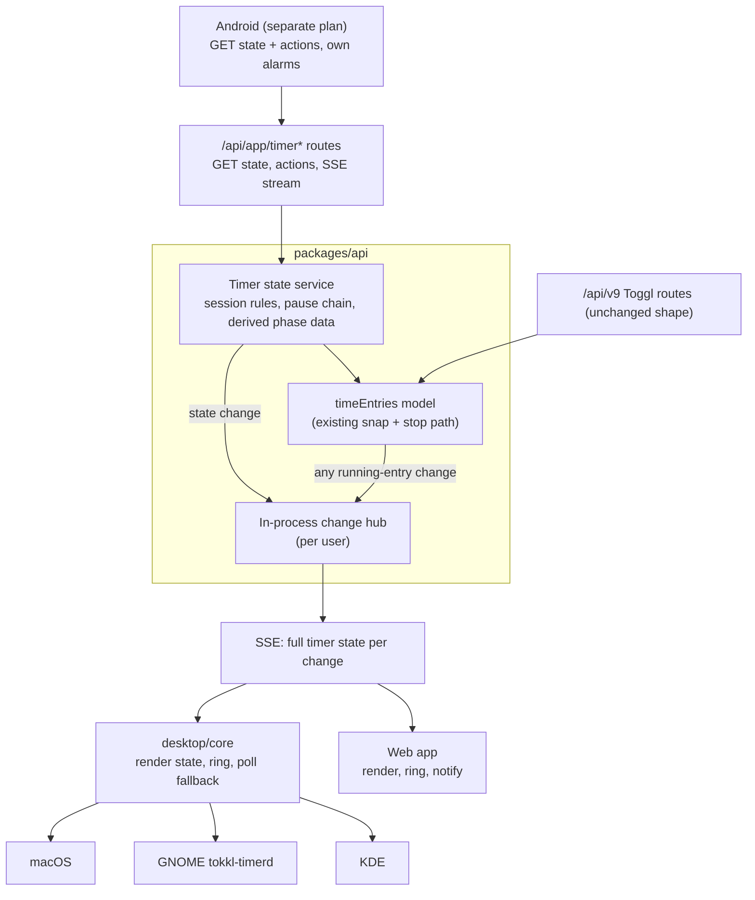
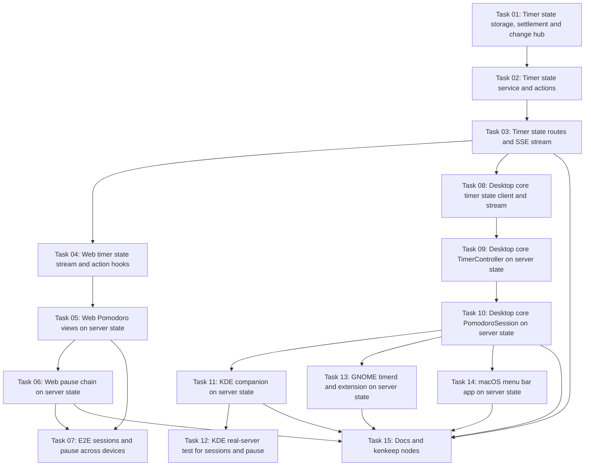

# Plan: Server-owned timer state with cross-device sync

## Original Work Order

> I want to have synchronization across devices that a Pomodoro is running. I don't want the Pomodoro handling to happen directly on the client. This is leading to a lot of duplication. There are some things that may still happen in the client, but If I start a Pomodoro in my KDE app bar, I want to see it running in my Android app and in the web app as well. What would that take? How do we pivot from the current architecture to what I'm describing?

## Plan Clarifications

| Question | Answer |
| --- | --- |
| The Android app is the sibling repo `tokkl-android`. How does this plan treat it? | Out of this plan. This plan defines the server contract. The user gets a separate prompt to create a plan in `tokkl-android`. |
| Which devices ring at a phase end? | Every signed-in client. Each computes the planned end from the server state. Next phase or End session on any device silences the others when the change reaches them. |
| How fast must a change reach other devices? | Server push with Server-Sent Events (SSE) for web and desktop, with polling as fallback. |
| What happens offline? | Session and pause actions need the server and fail with a clear message, as a timer start does. An active session keeps counting down and ringing from the last known state. |
| How does the server represent the open pomodoro? | As the running time entry, with session data next to it. Every Toggl-compatible client sees it running and can stop it, which ends the session. |
| Is backwards compatibility required? | No. The API change is additive. Web and desktop drop their device-local session code. A local session in flight at upgrade is dropped. Old clients keep working with device-local sessions that don't sync. |
| Does the timer's pause chain move to the server too? | Yes. |
| Scope approval (one timer state per user pushed over SSE; the server derives phase details; any stop of the pomodoro entry ends the session and a too-short pomodoro goes to the trash; Next phase and End session carry the revision the client saw; ringing, sounds, mode toggle and countdown stay on the client; Pause and Resume become server actions). | Approved as stated. |

## Executive Summary

Every client runs its own copy of the Pomodoro rules today. The web app keeps the session in `localStorage` with a Web Lock, a durable unsaved queue, retries and dedupe. `desktop/core` holds a C++ port of the cycle, the snapping rule, a save queue, a record and a store. Android has a third port in Kotlin. The server only stores the four length preferences and the stopped entries the clients post. No device can see a session another device started. The timer's pause chain has the same problem: the web keeps it in `localStorage`, desktop in `ChainStore`.

This plan makes the server own both. Per user it holds one timer state: the running entry, a paused chain, or a Pomodoro session whose open pomodoro is the running entry. The server applies every rule (phase changes, the long-rest count, saving each pomodoro, pause and resume, one thing running at a time) and returns the derived values clients used to compute: the planned end, the upcoming phase, the transition kind and the pomodoro number. An SSE stream sends the whole state to web and desktop on every change, including changes made through the Toggl v9 endpoints.

Clients keep what only a device can do. They draw the countdown, ring and play the sound, and hold device settings (desktop sound picks and Pomodoro mode, web notification permission). The web drops its session storage, unsaved queue, Web Lock, retry and pause chain storage. Desktop drops its cycle, snap, queue, record and chain store code. Android follows in its own plan against the same API.

## Context

### Current State vs Target State

| Current State | Target State | Why? |
| --- | --- | --- |
| Each client keeps its Pomodoro session on the device (web `localStorage`, desktop KConfig/QSettings, Android Room). | The server stores one session per user. Clients read it and send actions. | A session started on KDE must show on the web and the phone. |
| A pomodoro becomes a stopped entry that the client snaps, queues, posts, retries and dedupes. | The open pomodoro is the running entry. The server stops it on rest-to-work, End session or any other stop, and its existing stop path snaps it. | One write path. The queue, retry and dedupe code goes away from every client. |
| Clients detect a foreign running entry and end their session at its start. | Starting any other entry stops the pomodoro entry on the server, which ends the session. | The rule holds no matter which client starts the timer. |
| Clients compute planned end, transition and next phase from ported rules (`pomodoroSession.ts`, `pomodorocycle.cpp`, Android `Pomodoro.kt`). | The server returns them in the timer state. Clients subtract the current time and nothing more. | Removes two ports and keeps the fixtures as a server-side contract. |
| The pause chain lives on each device. A pause on KDE is invisible to the web. | Pause and Resume are server actions. The paused chain (fields and stored seconds) is part of the timer state. | The user asked to include it. Same duplication, same sync problem. |
| Web and desktop poll the current entry every 30 s. Android refreshes on foreground. | Web and desktop hold an SSE stream that sends the full timer state on connect and on every change. They fall back to polling while the stream is down. | Next phase on one device must silence the alarm on the others quickly. |
| Session actions work offline and save later. | Session and pause actions need the server. A running session counts down and rings offline from the last known state. | Online-only actions remove the offline queue that causes most of the duplication. |
| Two devices confirming Next phase at once would each advance a phase. | Next phase and End session carry the state revision the client saw. A stale revision gets 409. | Every client rings, so double confirms are likely. |

### Background

Facts verified in the tree on 2026-10-27:

- The API is Express 5 on `node:sqlite` (`DatabaseSync`), one Node process (`packages/api/src/index.ts`). Toggl-compatible routes are under `/api/v9` (`routes/togglV9.ts`). Tokkl's own routes are under `/api/app` (`routes/app.ts`). `requireAuth` accepts the session cookie and Basic auth with an API token or a password. No compression middleware is installed. There is no push transport of any kind.
- Stopped entries are snapped on every live write by `settleSpan` and `stopEntryAt` in `packages/api/src/models/timeEntries.ts`. A running entry keeps its exact start until it stops. A timer stop that rounds to zero goes to the trash and the reply carries `duration` 0 and `server_deleted_at`. `PATCH .../time_entries/:id/stop` accepts an optional `stop` instant. Starting an entry stops the user's running entry in any workspace.
- Session rules are in `packages/common/pomodoroSession.ts`, with cases in `packages/common/fixtures/pomodoroSession.json`. The four length preferences (`pomodoro_*`) are validated in `packages/api/src/models/users.ts`.
- Web session code: `PomodoroSessionProvider.tsx` and `pomodoroSession{Controller,State,Lifecycle,Lock,Retry,Alarm,Presentation}.ts`, plus `phaseNotification.ts`. Pause chain code: `pauseChain.ts`, `tabChain.ts`, `PauseCoordination.tsx`, `TimerBar.tsx`. Sign-out cleanup is in `lib/session.ts`. Current entry polling is in `api/hooks.ts` (30 s).
- Desktop core: `timercontroller.cpp` (current entry poll every 30 s, pause chain), `chainstore.*`, `pomodorocycle.*`, `snap.*`, `pomodoroqueue.*`, `pomodororecord.*`, `pomodorosession.*`, `pomodorostore.*`, `pomodoropreferences.*`, `pomodorosounds.*`. Platform users: KDE `appletchainstore.*` and `kdepomodoro.h`, GNOME `timerservice.*` with D-Bus `org.tokkl.Timer1`, macOS `menubarapp.cpp`. The core links Qt Core and Network only, and `desktop/core/ci/check.sh` fails if Qt Gui is linked.
- Android (`../tokkl-android`): Kotlin and Compose, OkHttp, Room. There is no push. It refreshes on foreground and network return, and every 15 min while a timer runs. Phase ends use `AlarmManager.setAlarmClock`. Its PRD lists cross-device session sync as out of scope. It copies `pomodoroSession.json` from tokkl commit `bed61cb`.
- `docs/PRD.md` T13 says "The session lives on the device. The server stores only the saved entries and the four defaults." This plan reverses that.

## Architectural Approach

### Timer state on the server

**Objective**: Hold one authoritative timer state per user and apply every session and pause rule there.

The state has four shapes: idle, a running entry, a paused chain, or a Pomodoro session. A running entry may be the resumed clone of a chain. A session and a chain never coexist.

- **Storage.** New tables hold the per-user session (entry id, the four lengths it started with, phase kind, phase start, completed count, pomodoro start) and the per-user pause chain (entry fields to clone, workspace, seconds stored so far, whether a clone is running). A per-user revision number increases on every change to the state, including running-entry changes that come through `/api/v9`.
- **Session rules.** The server runs `packages/common/pomodoroSession.ts` as it is, so the fixtures stay the contract. Start session ends any chain, stops the running entry at the session start, creates a running entry with the given fields and `created_with` from the client, and stores the session. The lengths default to the user's four preferences. A start request may override them, which keeps the web's per-session override. Work-to-rest changes the phase and leaves the entry running. Rest-to-work stops the entry at the confirm instant and starts a new running entry at the same instant, copying the fields of the entry it just stopped. Edits made to the running entry through any client therefore carry into the next pomodoro. End session stops the entry.
- **Instants.** The server clock sets every action instant. The state includes the server's current time so clients can correct for clock skew when they draw the countdown and decide when to ring.
- **Ending through other paths.** A stop, delete, edit that adds a stop, bulk PATCH or a new start that stops the pomodoro entry ends the session in the same transaction. That covers Toggl clients and old Tokkl clients. A clone that stops this way ends the pause chain too, except through Pause.
- **Too-short pomodoros.** They follow the existing timer-stop rule and go to the trash. The action reply and the state say which pomodoro was discarded, so the client can tell the user.
- **Pause chain rules.** These move from `pauseChain.ts` and `timercontroller.cpp` to the server. Pause stops the running entry and records its fields and stored duration. Resume starts a clone and keeps the chain. Discard (Stop while paused) clears the chain and writes nothing. Any start that is not a resume ends the chain, and a Pomodoro session start does too. Pause is refused during a session.
- **Concurrency.** Next phase, End session, Resume and Discard take the revision the client last saw. A different current revision gets 409 with the current state, so a second device's confirm does not skip a phase. All changes run inside one SQLite transaction.

### Timer state API and SSE stream

**Objective**: Give every client one way to read the state, one set of actions, and a push channel.

The endpoints live under `/api/app` because they are Tokkl's own and not part of the Toggl API. The `/api/v9` time entry shape does not change. Auth is `requireAuth`, so the cookie, an API token and a password all work. Cookie requests follow the CSRF rules `/api/app` already applies.

- `GET /api/app/timer` returns the state: `revision`, `server_time`, the running entry in the v9 shape or null, `pause` (fields and stored seconds) or null, and `pomodoro` or null. `pomodoro` holds the lengths, the phase (kind, start, completed count, planned end), the upcoming phase and transition kind, the pomodoro number in the cycle, the open pomodoro's start and entry id, and the last discarded pomodoro, if any.
- Actions return the new state: `POST /api/app/timer/pause`, `POST /api/app/timer/resume`, `POST /api/app/timer/discard`, `POST /api/app/pomodoro` (start, with optional fields and length overrides), `POST /api/app/pomodoro/next`, `POST /api/app/pomodoro/end`. Plain start and stop stay on the v9 endpoints. Changing the open pomodoro's project, billable flag, description or tags is a normal v9 edit of the running entry.
- `GET /api/app/timer/events` is an SSE stream. On connect it sends one `timer` event with the full state, then one on every change for that user. Every message is the full state, so a client that missed events loses nothing. A comment line goes out every 25 s to keep proxies from closing idle streams, and the response sets `X-Accel-Buffering: no`. The stream closes when the request's credential stops passing `stillSignedIn`, checked before each send and on the keep-alive tick.
- **Change hub.** An in-process, per-user publisher. Every write path that changes a user's running entry, pause chain or session publishes after its transaction commits. A single Node process is the deployment model, so no broker is needed.

### Web app on the server state

**Objective**: Make the web a thin view and controller of the server state.

- One provider opens the SSE stream with `EventSource` for the signed-in account and writes each state into TanStack Query. That feeds the timer bar, the Pomodoro page, the session banner, the page title and the current-entry cache. While the stream is down it polls `GET /api/app/timer` at the current 30 s cadence and on focus or reconnect.
- The Pomodoro page, banner and timer bar call the new actions. Their error messages cover offline and 409 (when another device changed the state first, the view refreshes to the server state).
- Ringing stays in `pomodoroSessionAlarm.ts` and the notification in `phaseNotification.ts`. Both are driven by the server's planned end and transition, corrected for `server_time`. The alarm stops when a state arrives with a different phase or no session.
- Delete the session storage, unsaved queue, Web Lock, retry and lifecycle modules, the `localStorage` pause chain (`pauseChain.ts` storage parts, `tabChain.ts`), the pause coordination that existed only to order local writes, and their sign-out cleanup and tests. Keep `pomodoroSessionPresentation.ts` and any helpers the views still use.

### Desktop core on the server state

**Objective**: Replace the core's session and chain logic with a client of the server state, shared by KDE, GNOME and macOS.

- **State client.** A new core component reads `GET /api/app/timer` and holds the SSE stream with `QNetworkAccessManager`, reading events as data arrives. It reconnects with backoff. While the stream is down it uses the existing 30 s poll and the existing wake and reconnect triggers. It stays Qt Core and Network only.
- **TimerController.** Running, paused and elapsed state come from the server state. Pause, Resume and Stop while paused call the new actions. The never-replay rule for unknown outcomes stays: an unknown result is settled by the next state read, never by resending. `ChainStore`, `SettingsChainStore`, KDE's `AppletChainStore` and the `confirmPause` list read go away.
- **Pomodoro session.** It becomes a view of `pomodoro` in the state plus local alarm state. It exposes the same properties the panels use today (phase, remaining or overtime, pomodoro N of M, upcoming phase, ringing transition) and calls start, next and end on the server. Ringing starts at the server planned end, corrected for skew, and stops when a state shows the phase changed or the session ended. An active session started on another device shows and can be controlled in either mode. The device's Pomodoro-mode toggle still decides what left-click starts when idle, and it stays locked while anything runs.
- **Removed.** `pomodorocycle.*`, `snap.*`, `pomodoroqueue.*`, `pomodororecord.*` and their tests, and the chain store. `pomodorostore.*` keeps only the mode and the per-transition sound picks. `pomodoropreferences.*` stays for the settings panes. `pomodorosounds.*` and the platform alarm players stay.
- **Platforms.** KDE, GNOME and macOS keep their menus, glyph, label, settings panes and sound players. `org.tokkl.Timer1` may change freely because `tokkl-timerd` and the extension ship together. Each platform drops its chain store wiring and anything that fed the removed core parts.

### Android contract

**Objective**: Let `tokkl-android` move to the same model in its own plan.

This plan does not touch `tokkl-android`. The API above is the contract. `docs/PRD.md` documents it in the API table so Android can implement against it. The fixtures README states that `pomodoroSession.json` is now the server's contract, so a client that reads the state from the server no longer needs a port.

## Risk Considerations and Mitigation Strategies

Technical Risks

- **A missed write path leaves a stale session or chain**: Any of the v9 entry paths (stop, delete, edit, bulk PATCH, start, restore, import) can end the pomodoro or chain entry.
    - **Mitigation**: Settle the session and chain in the time entry model functions, not in the routes. Add an API test per write path asserting the state and a published event.
- **SSE buffered by a reverse proxy**: nginx and similar proxies buffer responses by default, so events arrive late or never.
    - **Mitigation**: Send `X-Accel-Buffering: no` and a 25 s keep-alive comment. Document the proxy settings. Clients fall back to polling when no event or keep-alive arrives within a timeout.
- **Clock skew between devices**: A device whose clock runs fast rings early.
    - **Mitigation**: Every state carries `server_time`. Clients compute their offset from it and use the corrected time for the countdown and ringing.
- **Open streams pile up**: Every tab and every desktop app holds one connection.
    - **Mitigation**: Cap streams per user and close the oldest when over the cap. Close streams on sign-out, token rotation and suspension.
- **Edits from Toggl clients to the pomodoro entry**: Moving its start or adding a stop changes the session.
    - **Mitigation**: An edit that stops the entry ends the session. An edit to the start changes the open pomodoro's start only, never the phase timing. Tests cover both.

Implementation Risks

- **Deleting web and desktop code that other features use**: `snap.cpp` or helpers in `pauseChain.ts` may have callers beyond Pomodoro and pause.
    - **Mitigation**: Before deleting a module, list its callers in the live tree and keep or move what is still used.
- **The desktop never-replay rule regresses**: Moving pause and resume to server actions changes the unknown-outcome paths covered by `timercontrollertest.cpp` and `realservertest.cpp`.
    - **Mitigation**: Keep the existing tests for the unknown-outcome cases, rewritten against the new endpoints, and extend the real-server test to pause, resume and run a session.
- **In-flight local state at upgrade**: A web tab or desktop app that held a local session or pause chain drops it.
    - **Mitigation**: Accepted by the user (no BC). Release notes say so.

## Success Criteria

### Primary Success Criteria

1. A session started from the KDE panel shows on the web within 2 s with the same phase, countdown and pomodoro number, and the reverse holds too.
2. Next phase or End session on one client stops the alarm on every other connected web and desktop client within 2 s. A second confirm with a stale revision gets 409 and advances nothing.
3. Each rest-to-work confirm and each End session leaves exactly one snapped stopped entry on the server. A too-short pomodoro is in the trash and the client says so.
4. Starting a timer from any client, a plain Toggl client included, ends the session at that start and saves the open pomodoro.
5. Pause on one device shows as paused, with the same total, on every other web and desktop client. Resume and Discard work from any of them.
6. The web holds no Pomodoro or pause chain data in `localStorage`. `desktop/core` contains no cycle, snap, queue, record or chain store code. All existing and new tests pass (`npm test`, `npm run typecheck`, the e2e suite, and the desktop core, KDE, GNOME and macOS CTest suites that CI runs).

## Self Validation

1. Start the API with a fresh database. Create a user, set the time resolution to 1 through `PUT /api/app/admin/settings`, and save the API token.
2. Run `curl -N -u "$TOKEN:api_token" http://localhost:PORT/api/app/timer/events` in the background, writing to a file. Confirm the first event is the idle state.
3. With `curl`, start a session with `POST /api/app/pomodoro`, call `next` twice, then `end`, and check after each call that the stream file got a matching `timer` event with an increasing `revision`. Call `next` once more with an old revision and confirm 409.
4. Query `GET /api/v9/me/time_entries` and confirm one stopped entry per pomodoro, with snapped start and stop.
5. Start a session again, then start a plain timer with `POST /api/v9/workspaces/:wid/time_entries`. Confirm the state has no session and the pomodoro entry is stopped at the timer's start.
6. Pause and resume a plain timer through the new endpoints and confirm `pause` in the state and in the stream.
7. With Playwright CLI, open the web app in two browser contexts as the same user. Start a session in context A, take a screenshot of context B's Pomodoro page and banner showing the session, confirm Next phase in B, and capture A leaving the alarm state. Repeat for pause from A, observed in B.
8. Build `tokkl-timerd` and run it against the local server. Start a session with `gdbus call` on `org.tokkl.Timer1` and confirm in the Playwright browser that the web shows it. End it from the web and read the D-Bus properties to confirm the service shows no session.
9. Run the KDE real-server test (`desktop/kde/tests/realservertest.cpp`) with the session and pause cases added, against the same server.
10. Grep `packages/web/src` for `localStorage` keys `tokkl.pomodoroSession.` and `tokkl.pauseChain.`, and `desktop/` for `ChainStore`, `pomodorocycle`, `pomodoroqueue`, `pomodororecord` and `snap.h`. Expect no matches.

## Documentation

- `docs/PRD.md`: rewrite T13 so the server owns the session and the pause chain. Add the `/api/app/timer*` and `/api/app/pomodoro*` endpoints and the SSE stream to the API table. Update C6, C7 and C8 where they describe sessions. Update the note about client-specific preferences if it changes.
- `packages/common/fixtures/README.md`: the server now runs `pomodoroSession.json`. Clients that read the server state need no port.
- `desktop/kde/README.md`, `desktop/gnome/README.md`, `desktop/macos/README.md`: sessions and pauses are shared across devices and need a connection.
- `README.md` or the deployment docs: reverse proxy settings for SSE (no buffering, long read timeout).
- Kenkeep nodes under `.ai/kenkeep/nodes/` that describe the removed code (web Pomodoro session provider and Web Lock, the web pause chain, the KDE timer controller pause chain and chain store) must be updated or removed, and new nodes added for the timer state service and the SSE stream.

## Resource Requirements

### Development Skills

- TypeScript, Express 5 and `node:sqlite`, including streaming responses.
- React with TanStack Query, and `EventSource`.
- C++ and Qt 6 Core/Network (`QNetworkAccessManager` streaming reads), QML for KDE, GJS for the GNOME extension, Objective-C++ for macOS.
- Playwright for e2e.

### Technical Infrastructure

- No new runtime dependencies. SSE uses Node's HTTP response, the browser's `EventSource` and `QNetworkReply`.
- Existing CI jobs for the API, web e2e, desktop core, KDE, GNOME and macOS.

## Integration Strategy

The server ships first in the same release as the clients, because web and desktop release together with it. Old Android builds keep working: they see a running pomodoro entry as a foreign timer and end their own local session, as today. Android moves to the new API in its own plan.

## Notes

- Online-only actions are a deliberate trade. The device-local offline queue was the largest source of duplicated logic.
- The four length preferences and their validation do not change.

## Task Dependencies

No circular dependencies. Tasks 09 and 10 change the core API, so the KDE, GNOME and macOS builds stay broken until tasks 11, 13 and 14. Tasks 05 and 06 remove behaviour that the old e2e specs test, so those specs stay red until task 07.

## Execution Blueprint

**Validation Gates:**
- Reference: `/config/hooks/POST_PHASE.md`

### ✅ Phase 1: Server storage and settlement
**Parallel Tasks:**
- ✔️ Task 01: Timer state storage, settlement on every entry write, and the change hub

### ✅ Phase 2: Server rules
**Parallel Tasks:**
- ✔️ Task 02: Timer state service: derived state, session actions and pause actions (depends on: 01)

### ✅ Phase 3: Server API
**Parallel Tasks:**
- ✔️ Task 03: Timer state routes and SSE stream (depends on: 02)

### ✅ Phase 4: Client state foundations
**Parallel Tasks:**
- ✔️ Task 04: Web timer state stream and action hooks (depends on: 03)
- ✔️ Task 08: Desktop core: timer state client and SSE stream (depends on: 03)

### ✅ Phase 5: Sessions and timer controller
**Parallel Tasks:**
- ✔️ Task 05: Web Pomodoro views on the server state (depends on: 04)
- ✔️ Task 09: Desktop core: TimerController on the server state (depends on: 08)

### ✅ Phase 6: Pause chain and session view
**Parallel Tasks:**
- ✔️ Task 06: Web pause chain on the server state (depends on: 05)
- ✔️ Task 10: Desktop core: PomodoroSession on the server state, and removal of the ported rules (depends on: 09)

### ✅ Phase 7: E2E and desktop platforms
**Parallel Tasks:**
- ✔️ Task 07: E2E: Pomodoro sessions and pause on the server state, across devices (depends on: 05, 06)
- ✔️ Task 11: KDE companion on the server state (depends on: 10)
- ✔️ Task 13: GNOME tokkl-timerd and extension on the server state (depends on: 10)
- ✔️ Task 14: macOS menu bar app on the server state (depends on: 10)

### ✅ Phase 8: Real-server test and documentation
**Parallel Tasks:**
- ✔️ Task 12: KDE real-server test: sessions, pause and the stream (depends on: 11)
- ✔️ Task 15: Docs and kenkeep nodes for the server-owned timer (depends on: 03, 06, 10, 11, 13, 14)

### Post-phase Actions

### Execution Summary
- Total Phases: 8
- Total Tasks: 15

## Execution Summary

**Status**: ✅ Completed Successfully
**Completed Date**: 2026-10-28

### Results

All 8 phases and 15 tasks are complete on `feature/3--server-owned-timer-state-and-cross-device-sync`, in 10 commits from `6c78f5e` to `cc8d027` on top of the Strikethroo 4.4.1 update (`59acff8`).

- The API keeps one timer state per user (running entry, pause chain or Pomodoro session), settles it on every entry write, serves it at `GET /api/app/timer` with six revision-checked actions, and pushes it over `GET /api/app/timer/events`.
- The web follows the stream, polls only while it is down, and keeps no session or pause data in `localStorage`. Its session store, unsaved queue, Web Lock, retry, lifecycle, pause chain and tab chain modules are deleted.
- `desktop/core` has a shared `TimerStateClient`; `TimerController` and `PomodoroSession` are views of the server state. The cycle, snap, queue, record and chain store code is deleted. KDE, GNOME and macOS run on it.
- Docs, PRD and kenkeep nodes describe the new model, including reverse proxy settings for the stream.

Verification on the final tree: `npm test` (api 245, common 155 after the cleanup, web 113, root 226), `npm run typecheck`, `check:tracker-refs` and `npx kenkeep lint` all pass. `npm run test:e2e -- --workers=2` passed 335/335 on the phase 7 tree; phase 8 did not touch the web. `desktop/core/ci/check.sh` 10/10; KDE `container-check.sh --format deb` 25/25 with the package check; KDE `realserver.sh` 14/14 Qt cases and 3/3 node tests; GNOME `ci/check.sh` 15/15 and the extension harness on Shell 50; macOS portable library 12/12 on Qt 6.11.2. Self Validation steps 1 to 10 all passed: curl against a fresh server (revisions 0 to 4 on the stream, 409 on a stale revision, snapped stopped entries, a v9 start ending the session at its start, pause and resume in the stream); two browser contexts (session visible in B 35 ms after A started it, A's alarm cleared 61 ms after B's Next phase, pause seen in B after 62 ms); `tokkl-timerd` starting a session over D-Bus that the web showed and ended; the KDE real-server test; and the greps for removed keys and modules.

### Noteworthy Events

- Code review gate result, verbatim: `{"kind":"skipped","reason":"review-disabled","detail":"Code review is disabled. Set code_review.enabled to true in config/config.yaml or select Enable code review in Customize to opt in.","action":"continue","codeReview":"Skipped; Code review is disabled. Set code_review.enabled to true in config/config.yaml or select Enable code review in Customize to opt in."}`. No findings were produced, so none were acted on or ignored.
- The feature branch script refused the uncommitted Strikethroo 4.4.1 update. It was committed separately as `59acff8` and the review base commit was captured again at that commit, so the plan diff excludes it.
- The user asked for task workers at `high` effort, never `max`. Workers ran at `high` (or `medium` for docs) even where the route asked for `xhigh` or `max`.
- The T3 cgroup ran over its 5 GiB memory.high for hours because of another project's C++ builds. The docker CLI and host builds stalled for up to 40 minutes, a T3 restart cancelled the phase 6 workers mid-run (both were resumed from their transcripts), and one GNOME extension check hung in GNOME Shell teardown after passing (re-run clean).
- The first full e2e run had 112 failures across unrelated specs. Running the same specs on main under the same load showed more failures there (68 vs 49 of 88), so the cause was load; the suite passes reliably with 2 workers on this host. Four real failures caused by the timer stream were fixed in the specs.
- The web action hooks had two bugs found by their first caller: TanStack Query held offline mutations for replay (fixed with `networkMode: 'always'`), and an edit followed by Next phase sent a stale revision (fixed by waiting for the tab's own writes and re-reading the revision only when phase and pause are unchanged).
- The post-execution cleanup removed `overtimeSeconds` and `pomodoroEntrySpan` from `packages/common/pomodoroSession.ts` with their 18 fixture cases (`cc8d027`), since their only caller was the deleted web controller.
- The task 10 brief said `pomodorostore.*` keeps the per-transition sound picks; it never held them. The store now holds only the mode. The Pomodoro lengths are no longer remembered across restarts while offline.
- The GNOME D-Bus interface gained `CanStartSession`. The KDE menu disables Project and Billable during a session.

### Necessary follow-ups

- Desktop transport resends a POST when the connection closes before any reply byte (Qt rewinds the `QByteArray` body). This predates the plan (`transport.cpp` on main sends the same way) but now surfaces as a false 409 on a resent action, and a resent v9 start can duplicate an entry. Passing the body as a sequential `QIODevice` should stop it. The KDE real-server test cuts replies partway to avoid it.
- Decide whether the web timer bar's fields stay read-only while paused or whether the server gains an action to edit a paused chain.
- Confirm the KDE choice to disable Project and Billable during a session.
- The web timer bar's Start and Continue send the browser clock as the new entry's start (older behaviour). With a skewed device clock, a session ended that way stops at the server's time, not the new start.
- The Android app (`tokkl-android`) needs its own plan against the new API.
- Release notes: a local session or pause in flight at upgrade is dropped, and old Android builds keep device-local sessions that don't sync.
- The macOS `*.mm` shims were only reviewed by hand; the `macos` CI job is their first real build. GNOME Shell versions other than 50 are covered by the `gnome-extension` CI matrix.
