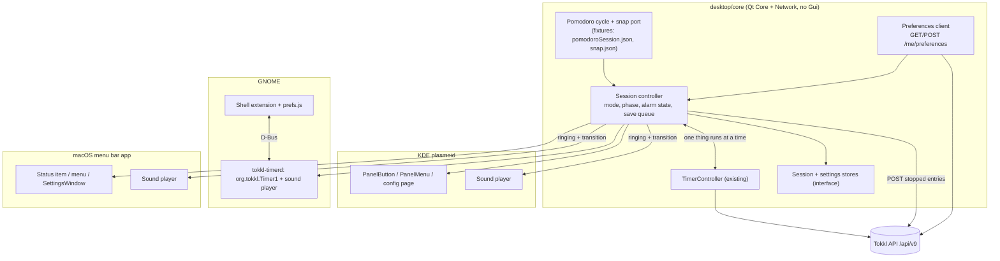
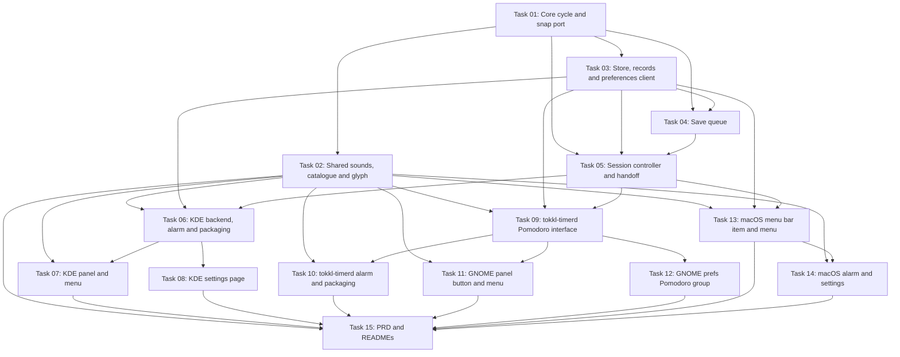

# Plan: Pomodoro mode for the KDE, GNOME and macOS tray apps

## Original Work Order

> I want to give support to the taskbar apps for KDE, GNOME, and macOS to manage Pomodoro's. Now it's going to be a simple UX in which you cannot override Pomodoro values per Pomodoro instead. The settings are managed inside of the settings pane for the app. Whatever that is for Katie Igano and macOS. I will need you to propose a UX that is simple for managing the Pomodoro as opposed to the timer. My thinking is to have a right click switch between timer and Pomodoro mode and some sort of indicator once that has happened for the user that what is running is a timer or a Pomodoro. Notice that you will also have to follow the same rules for alarms, doing the switch between Pomodoro phases and make the sounds configurable using the settings screen for the app. I probably left out many gaps. on how this will work, but you have the example implementation for the web app and the example implementation for the Android app which is a sibling of this project. Inspect those before asking me about any gaps, but don't hesitate. to ask for clarifications if you need some.

("Katie Igano" is a speech-to-text rendering of "KDE, GNOME".)

## Plan Clarifications

| Question | Answer |
| --- | --- |
| Right-click already opens the menu on all three apps. How does the user switch between Timer and Pomodoro? | A checkable "Pomodoro mode" item in the existing right-click menu, remembered on the device. Left-click acts on the active mode. |
| In Pomodoro mode, what does left-click do mid-phase, before the planned end? | It opens the menu. Left-click starts a session when idle and confirms Next phase while the alarm rings. |
| Can the mode change while a timer runs or is paused, or a session is active? | No. The item is locked, like Project while a timer runs. |
| How does the panel item show Pomodoro mode and the phase? | An hourglass glyph next to the logo whenever Pomodoro mode is on. The label counts the phase down as M:SS, then shows +M:SS in overtime. Tooltip and accessible text name the phase. Timer mode looks as it does today. |
| Where are the four lengths stored? | In the existing server preferences (`pomodoro_*` keys via `/api/v9/me/preferences`), shared with web and Android, cached locally. Every session uses them; no per-session override. |
| What does "configurable sounds" mean? | Per transition, pick one of the four bundled sounds, with a Preview button. Defaults match web and Android. Stored on the device only. Looping and dismissal rules are unchanged. |
| Post a desktop notification at phase end? | No. Sound plus the overtime label only. |
| Is backwards compatibility required? | No. The GNOME extension and `tokkl-timerd` ship together, so `org.tokkl.Timer1` can change freely. |
| Can Project and Billable change during a session? | Yes, as on the web. A change applies to the open pomodoro and the ones after it. |
| What happens in Pomodoro mode when a timer started on another device is running? | The item shows and controls that timer as in Timer mode. A session can start once the timer stops. (Proposed during planning, approved by the user.) |

## Executive Summary

The web app and the Android app already run Pomodoro sessions: work phases split by short rests, a long rest after every N work phases, a looping sound per transition, and phases that change only when the user confirms. Each pomodoro, a work phase plus the rest after it, is saved as one stopped time entry. The KDE, GNOME and macOS tray apps have none of this. They start, pause and stop a plain timer, and they never read user preferences.

This plan adds a Pomodoro mode to the three tray apps that follows the web's session rules. The session logic goes into `desktop/core`, ported from `packages/common/pomodoroSession.ts` and checked against the same JSON fixtures, so all three apps behave alike. Each platform adds only its own surface: a mode item and session items in the right-click menu, an hourglass glyph and a countdown in the panel label, a sound player, and a Pomodoro section in its settings pane.

The UX stays small on purpose. There is no new window and no notification. The lengths are the account's shared preferences, so a session cannot override them. The only per-device settings are the mode and the sound for each transition.

## Context

### Current State vs Target State

| Current State | Target State | Why? |
| --- | --- | --- |
| The tray apps only run a plain timer. | Each app has a Timer mode (unchanged) and a Pomodoro mode, chosen with a checkable menu item. | The user wants Pomodoro sessions from the panel. |
| Left-click starts, pauses or resumes the timer. | In Timer mode, the same. In Pomodoro mode: start a session when idle, Next phase while ringing, open the menu mid-phase. A timer that is running still gets Timer-mode clicks. | One click does the obvious thing without risking an accidental skip. |
| The panel shows the logo, a project dot and the elapsed time as H:MM. | Pomodoro mode adds an hourglass glyph. During a session the label counts down as M:SS, then +M:SS in overtime. | The user must see whether a timer or a Pomodoro is running. |
| The apps never read `/me/preferences`. | `desktop/core` reads and writes the four `pomodoro_*` preferences and caches them on the device. | The lengths are shared with web and Android and edited in each app's settings pane. |
| Settings panes hold connection and appearance settings only. | Each settings pane gains a Pomodoro section: the four lengths and a sound picker for each of the four transitions, with Preview. | The user asked for lengths and sounds in the settings pane. |
| The apps cannot play sound. | At a phase's planned end, the sound chosen for that transition loops until Next phase or End session. | The alarm rules must match web and Android. |
| `desktop/core` has no Pomodoro or snapping logic. | A C++ port of `pomodoroSession.ts` and `snapSpan`, tested against `pomodoroSession.json` and `snap.json`. | The fixtures are the contract other clients port from. One port keeps three apps in line. |
| `org.tokkl.Timer1` exposes timer state only. | `org.tokkl.Timer1` also exposes the mode, session state, settings and session actions. | The GNOME extension holds no logic. It reads and calls `tokkl-timerd`. |

### Background

**Rules taken from the web app** (`packages/common/pomodoroSession.ts`, `packages/web/src/components/pomodoroSession*.ts`, `docs/PRD.md` T13):

- Phases are work, short rest and long rest. A work phase is followed by a long rest when `completed + 1 >= longRestEvery`, otherwise by a short rest. Every rest is followed by work. Skipped work phases count. The count resets after a long rest.
- A phase changes only when the user confirms Next phase. Confirming before the planned end is a skip. After the planned end the phase runs in overtime until the user confirms. End session works at any time.
- At the planned end, the transition's sound loops until Next phase or End session. There is no control that only silences it.
- One pomodoro is one stopped entry. It runs from the work start to the next confirmed work start, or to the session end. Both ends snap to the account's `time_resolution_minutes` in the account time zone. The next pomodoro starts at the previous one's unsnapped end. A span whose ends snap to one point is not saved, and the user is told.
- A work-to-rest confirm saves nothing. The save happens on a rest-to-work confirm, on End session, or when a timer start ends the session.
- One thing runs at a time. Starting a session stops the running timer at the session start. Starting a timer ends the session at the timer's start and saves the partial pomodoro. A running entry seen on the server that this client did not start, with a start after the pomodoro start, ends the session at that entry's start.
- Sessions live on the device only. The server stores the saved entries and the four preferences. Ended pomodoros wait in a durable queue. Before an item that was already tried is posted again, the queue checks `GET /me/time_entries` for an exact match.
- The four sounds are `packages/web/public/sounds/pomodoro-{work-to-short-rest,short-rest-to-work,work-to-long-rest,long-rest-to-work}.wav`: 16-bit mono PCM WAV that loops without a gap, with FFmpeg recipes and SHA-256 sums in `docs/sounds/README.md`. Android ships byte-identical copies.

**Differences on desktop, decided with the user:**

- No per-session override of the lengths. Web and Android allow one; the tray apps use the account preferences.
- Sounds can be chosen per transition, which neither web nor Android allows. The choice is limited to the four bundled sounds.
- No notification, no pause in Pomodoro mode, no description field. Desktop timers already save an empty description.

**Desktop facts this plan builds on** (verified in the tree on 2026-10-26):

- `desktop/core` is a Qt 6 Core and Network static library. Its CI fails if Qt Gui is linked (`desktop/core/ci/check.sh`). `TimerController` polls `GET /me/time_entries/current` every 30 s, runs one mutation at a time, never replays a start or resume, and persists a pause chain through `ChainStore`. KDE uses KConfig for it, macOS QSettings, and `tokkl-timerd` its own QSettings.
- Right-click (or Control-click on macOS, or the Menu key) opens the menu. Left-click calls `toggle()`. The menus are in `desktop/kde/package/contents/ui/PanelMenu.qml`, `desktop/gnome/extension/indicator.js` and `desktop/macos/src/statusmenu.cpp`.
- Settings panes: the KDE plasmoid config (`config/main.xml`, `ui/configGeneral.qml`), GNOME `prefs.js` (GSettings plus D-Bus `Configure` on `tokkl-timerd`) and the macOS `SettingsWindow` (QSettings).
- `Me` in `desktop/core/src/apitypes.h` decodes id, email, full name, time zone, default workspace and beginning of week. It does not decode `time_resolution_minutes`.
- No desktop code mentions Pomodoro, notifications or sound.

## Architectural Approach

The work splits into one shared layer and three thin platform layers. `desktop/core` owns every rule: the cycle, the session, the handoff with the timer, saving entries, preferences and alarm state. Each platform renders that state and plays the sound when core says the alarm is ringing.

### Shared cycle and snapping port

**Objective**: Give all three apps one tested copy of the web's Pomodoro rules.

Port the functions in `packages/common/pomodoroSession.ts` (`startSession`, `plannedEnd`, `overtimeSeconds`, `transitionKind`, `nextPhase`, `pomodoroEntrySpan`) and the `snapSpan` they rely on into `desktop/core`. Like the originals, they keep no state and read no clock. The core autotests read `packages/common/fixtures/pomodoroSession.json` and `snap.json` directly from the repository and run every case, so a change to the web rules that the port misses fails the desktop build. The config ranges and defaults (25/5/15/4, ranges 1–180, 1–60, 1–60, 1–12) come from the same source. `Me` gains `time_resolution_minutes` so entries snap on the account's grid.

### Session controller and timer handoff

**Objective**: Run a session on the device with the web's save and handoff rules, next to the existing timer.

A new core component holds the session: the mode (Timer or Pomodoro), the current phase, the exact start of the open pomodoro, the alarm state, and a queue of ended pomodoros not yet saved. It exposes the state the panels need (phase kind, remaining or overtime seconds, "Pomodoro N of M", next phase kind, whether the alarm rings and for which transition, whether the mode can change) and the actions Start session, Next phase and End session. Core rules:

- **Mode.** Stored per device through the store interface. Changing it is refused while a timer runs or is paused, or while a session is active.
- **Left-click.** In Pomodoro mode `toggle()` starts a session when nothing runs and confirms Next phase while ringing. Mid-phase it does nothing in core, and the platform opens the menu instead. When a timer is running or paused, `toggle()` keeps its Timer-mode behaviour whatever the mode.
- **Start session.** Allowed only in Pomodoro mode with no timer running or paused. It uses the cached preferences and the Project and Billable currently shown in the menu.
- **Phase end.** No auto-advance. Once the planned end passes, the phase is ringing, including right after a restart or a wake from sleep. It keeps ringing until Next phase or End session.
- **Saving.** On rest-to-work, End session or a handoff, the ended pomodoro is snapped, written to the durable queue together with the session change, and then posted as a stopped entry with `created_with` set to the client name. A span too short to keep is dropped and the user is told in the menu status line. Retries back off; before posting an item that was already tried, the queue looks for an exact match on the server. The web's rule for 4xx answers (drop with the server's message, except 401, 408 and 429) carries over.
- **Handoff.** The existing 30 s poll of the current entry feeds the session. A running entry this client did not start, with a start after the pomodoro start, ends the session at that entry's start and saves the partial pomodoro. The Start item in the menu is the only way to start a timer locally, and it is unavailable in Pomodoro mode, so a local timer start never has to end a session.
- **Project and Billable.** These stay editable during a session. A change applies to the open pomodoro and the ones after it, and changes nothing on the server until a pomodoro is saved.
- **Reconfiguring or signing in again.** Before the connection changes, the session ends and its queue is flushed, as the web does on sign-out.

Persistence uses a new store interface next to `ChainStore`, implemented with KConfig on KDE, QSettings on macOS and the `tokkl-timerd` config on GNOME.

### Preferences client

**Objective**: Share the four lengths with web and Android and let each settings pane edit them.

Core reads `GET /api/v9/me/preferences` when it connects and on the existing refresh path, and keeps only the four `pomodoro_*` keys. A missing or invalid value falls back to its default one key at a time, as the server does. The values are cached through the store interface, so a session can start offline with the last known lengths. Saving from a settings pane posts only the keys that changed and shows any 400 message from the server next to its field. A session in progress keeps the lengths it started with.

### Sound player per platform

**Objective**: Loop the chosen sound for a transition while core reports the alarm ringing, and play a preview from the settings pane.

The four bundled WAVs are the sounds to choose from. They are byte-identical to `packages/web/public/sounds/`, and their SHA-256 sums are checked against `docs/sounds/README.md` in a test. If the packaging builds can read them from `packages/web/public/sounds` they are used from there; otherwise they are copied with a recorded source and checksum, as Android does. Core stays free of Qt Gui. It publishes the ringing transition, and each platform owns playback:

- **KDE:** the plasmoid's C++ backend plays the sound with a looping sound effect. Qt Multimedia is the expected choice; the decision and its packaging dependencies are confirmed during implementation.
- **GNOME:** `tokkl-timerd` plays the sound, so the alarm keeps working whatever state the Shell extension is in. If a sound dependency in the service turns out to be unsuitable for the Debian and Fedora packages, the fallback is playback from the extension.
- **macOS:** the app plays the sound with a looping player available to a Qt Widgets app (Qt Multimedia or AppKit `NSSound`).

The sound for each transition is a per-device setting with the matching sound as its default. Playback stops the moment core leaves the ringing state.

### Panel item and menu per platform

**Objective**: Make the mode visible, and offer the session actions without a new window.

All three platforms follow the same design, each in its own idiom:

- **Panel label.** In Pomodoro mode an hourglass glyph sits next to the logo. During a session the label shows the time left as `M:SS`, then `+M:SS` in overtime. Tooltip and accessible name read, for example, "Short rest · 4:10 left · Pomodoro 2 of 4". With no session, Pomodoro mode shows the glyph alone. Timer mode, and any running or paused timer, look exactly as they do today. The glyph is a new monochrome-friendly asset that follows the existing colour and monochrome icon settings.
- **Left-click.** It follows the core rules above. Mid-phase it opens the menu.
- **Menu.** The status line shows the phase, the time left or overtime, and "Pomodoro N of M". When a session is possible or active the menu offers **Start session**, **Next phase: Short rest / Long rest / Work** and **End session**. Project and Billable work as today, except that they stay enabled during a session. A checkable **Pomodoro mode** item shows "(locked while running)" when locked. Start Timer and Stop Timer appear only in Timer mode, or while a timer runs.

The GNOME menu, label and accessible name are built in `indicator.js` from new `org.tokkl.Timer1` properties, with methods for the actions and the mode. The extension's 1 s tick also runs during a session. Since backwards compatibility is not required, the interface changes in place, and its XML and the copy checked by `timer1.test.js` move together.

### Settings panes

**Objective**: Edit the four lengths and the four sounds where each platform keeps its settings.

- **KDE:** a "Pomodoro" category or group in the plasmoid configuration, with four number fields (range hints and validation) and four sound pickers with Preview. The lengths save through core to the server. The sounds save to the applet configuration.
- **GNOME:** a "Pomodoro" `Adw.PreferencesGroup` in `prefs.js`, with spin rows for the lengths and combo rows plus a preview button for the sounds. Both read and write through `tokkl-timerd` over D-Bus: the lengths go on to the server, and the sound choices are stored in the service config.
- **macOS:** a Pomodoro section in `SettingsWindow` with the same fields. The lengths save through core and the sounds go to QSettings.

The length fields need a working connection. Without one they show the cached values read-only and say why.

## Risk Considerations and Mitigation Strategies

Technical Risks

- **Audio dependencies in packaging**: Qt Multimedia, or another player, adds runtime dependencies to the DEB, RPM, GNOME packages and the DMG, and CI uses pinned images.
    - **Mitigation**: Pick the player per platform early in implementation, add the dependency to each packaging spec and CI image, and keep `desktop/core` free of it. Fall back to playback in the GNOME extension if the service cannot take the dependency.
- **Gapless looping**: Some players add a gap or re-trigger late, which breaks the loop.
    - **Mitigation**: Use the bundled WAVs, which are designed to loop, and the player's native loop mode. Listen to each sound during self-validation.
- **Time-zone snapping in C++**: `snapSpan` depends on IANA wall-clock rules.
    - **Mitigation**: Run every case in `snap.json` against the port with `QTimeZone`, including the DST cases.
- **Sleep and restart in mid-phase**: The planned end can pass while the machine sleeps or the app is closed.
    - **Mitigation**: Derive ringing from the stored phase and the clock on every tick and on wake (the existing late-tick check and the macOS wake hook), so the alarm starts as soon as the app runs again.

Implementation Risks

- **Three UIs drifting apart**: KDE (QML), GNOME (GJS over D-Bus) and macOS (Qt Widgets plus Objective-C++) render the same state differently.
    - **Mitigation**: Keep the wording, labels and rules in core where possible (the existing `StatusText` and `statuswords` patterns), and write the same scenarios into each platform's tests.
- **macOS cannot be built locally**: The Objective-C++ files compile only on the CI `macos` job.
    - **Mitigation**: Keep logic in the portable library that is tested on Linux, keep Objective-C++ changes small, and treat the CI `macos` job as a required check.
- **Duplicate or lost entries**: A save that fails mid-request can post twice or not at all.
    - **Mitigation**: Write the queue before posting, check for an exact match before a retry, and test both paths with the fake transport.

Scope Risks

- **Creep towards web features**: pause, descriptions, notifications, custom sounds and session sync are easy to add on the way.
    - **Mitigation**: They are out of scope by the user's decision. Anything beyond the clarifications table needs a new work order.

## Success Criteria

### Primary Success Criteria

1. On KDE, GNOME and macOS, the right-click menu has a checkable "Pomodoro mode" item that is locked while a timer runs or is paused, or while a session is active. The mode survives an app restart.
2. In Pomodoro mode the panel item shows the hourglass glyph. During a session it shows `M:SS` remaining, then `+M:SS` overtime. Timer mode looks the same as before this change.
3. The core port passes every case in `packages/common/fixtures/pomodoroSession.json` and `snap.json`.
4. A session follows the web rules: phases change only on Next phase; early confirms count as skips; the long rest follows every N work phases; at each planned end the chosen sound loops until Next phase or End session; each pomodoro is saved as one stopped entry with snapped ends; spans that are too short are reported and not saved.
5. A timer started on another device ends a running desktop session within one poll, and the partial pomodoro is saved.
6. Changing a length in any app's settings pane changes the matching `pomodoro_*` preference on the server, and the web settings page shows the new value. A value changed on the web is used by the next desktop session.
7. Each settings pane offers one of the four bundled sounds per transition with a working Preview, and the alarm plays the chosen sound.
8. Existing desktop tests and CI jobs (`core`, `kde`, `gnome`, `gnome-extension`, `macos`) pass, with new tests covering the port, the session controller, the preferences client, the D-Bus interface and each platform's menu and label.

## Self Validation

Run these after all tasks are done. Use a local Tokkl server with a test account whose `time_resolution_minutes` is 1, and set the lengths to 1/1/1 and long rest every 2, so a full cycle takes a few minutes.

1. Build and test core in its pinned container with `desktop/core/ci/check.sh`. Confirm that the fixture-driven tests run every case in `pomodoroSession.json` and `snap.json` (the test log shows the case count), and that the check still rejects a Qt Gui link.
2. Run `desktop/gnome/ci/check.sh` (service CTest, D-Bus activation), then the extension harness `desktop/gnome/extension/ci/check.sh` for one Shell version only, such as 49. The `gnome-extension` CI job covers 46–51 on the PR.
3. Run `desktop/gnome/extension/ci/realservice.sh` against the local server. With `busctl --user` or `gdbus`, set Pomodoro mode, start a session, read the phase and remaining-time properties until the phase rings, and confirm that the ringing property names `workToShortRest`. Call Next phase twice, then `curl` `GET /api/v9/me/time_entries` and confirm one stopped entry spanning the first work phase and its rest, with `created_with` `tokkl-gnome`.
4. Run the KDE container check for Debian 13 (`desktop/kde/scripts/container-check.sh` with the Debian leg) and `desktop/kde/ci/realserver.sh`, and confirm that the new panel QML tests for the mode item, the lock, the glyph and the countdown pass.
5. On the headless sway session (`WAYLAND_DISPLAY=wayland-headless`), run the plasmoid with `plasmawindowed` against the local server, switch to Pomodoro mode, start a session, and take screenshots of the panel item in Work, in overtime and in a short rest, and of the open menu. Check the glyph, the `M:SS` and `+M:SS` labels, the "Pomodoro N of M" status line and the locked mode item.
6. During step 5, confirm the alarm plays: run `pactl list sink-inputs` while it rings and see a stream from the plasmoid process; it disappears after Next phase.
7. Change the work length in the KDE settings pane, then `curl` `GET /api/v9/me/preferences` and confirm `pomodoro_focus_interval_in_minutes` changed. Use `curl` `POST` to set it back and confirm the plasmoid's settings pane shows the server value after a refresh.
8. Start a session in the plasmoid, start a timer for the same account with `curl` `POST /api/v9/workspaces/{wid}/time_entries`, and confirm within 30 s that the panel shows the running timer, the session has ended and a partial pomodoro entry exists.
9. Build and run the portable macOS library tests on Linux (`desktop/macos` CTest, the `menubarapp` test). Push the branch and confirm that the CI `macos` job passes, since the `.mm` files compile only there. Record in the PR that the macOS UI was not checked by hand.
10. Run `sha256sum` on the desktop copies of the sounds, if copies exist, and compare the sums with `docs/sounds/README.md`.

## Documentation

- `docs/PRD.md`: update rows C6, C7 and C8 to list Pomodoro mode, and note in T13 that the desktop companions use the shared lengths without a per-session override and let the user pick a sound per transition.
- `desktop/kde/README.md`, `desktop/gnome/README.md`, `desktop/macos/README.md`: describe Pomodoro mode, the click behaviour, the indicator and the settings. Extend the KDE manual checklist with the Pomodoro steps.
- `docs/sounds/README.md`: record any desktop copies of the sounds and where they are used.
- `AGENTS.md`: no change. It does not mention the desktop apps (checked on 2026-10-26).
- Kenkeep: after the work lands, curate nodes for the desktop session controller and the per-platform sound players. Do not edit kenkeep nodes inside this plan's tasks.

## Resource Requirements

### Development Skills

- C++20 and Qt 6 (Core, Network, D-Bus), including `QTimeZone` and a test design with fakes.
- QML and Kirigami for the Plasma 6 plasmoid and its configuration page.
- GJS for GNOME Shell 46–51 and libadwaita preferences.
- Qt Widgets and Objective-C++ for the macOS menu bar app.
- Audio playback on each platform: Qt Multimedia, PipeWire/PulseAudio and macOS audio.

### Technical Infrastructure

- The existing pinned CI containers for `core`, `kde`, `gnome` and `gnome-extension`, and the `macos-latest` job. Any sound dependency must be added to those images and to the DEB, RPM and DMG packaging.
- The local Tokkl API for the real-server checks, and the headless sway session for screenshots.
- The bundled WAVs in `packages/web/public/sounds` with their recipes in `docs/sounds/README.md`.

## Integration Strategy

- `TimerController` keeps its contract. The session controller sits next to it in core and hooks into the poll result and the start path. It does not change how the timer works.
- The preferences client only posts the four `pomodoro_*` keys, so the server's merge semantics leave other clients' keys alone.
- Saved pomodoros are plain stopped entries, so reports, the calendar and the other clients need no change.

## Notes

- The web code still has stale comments, in `packages/common/pomodoroSession.ts:2-3` (a removed `pomodoro.ts`) and `packages/web/src/api/hooks.ts:41` (the removed on/off model). They are out of scope here but worth a separate clean-up.
- The rule that a timer running from another device takes over the panel item in Pomodoro mode was proposed during planning and approved by the user.

## Task Dependencies

No circular dependencies. Task 12's Preview button makes sound only once task 10 lands; that is a soft dependency and is not drawn.

## Execution Blueprint

**Validation Gates:**
- Reference: `/config/hooks/POST_PHASE.md`

### ✅ Phase 1: Core rules port
**Parallel Tasks:**
- ✔️ Task 01: Port the Pomodoro cycle and snapping rules to desktop/core

### ✅ Phase 2: Shared assets and persistence
**Parallel Tasks:**
- ✔️ Task 02: Shared Pomodoro sounds, sound catalogue and hourglass glyph (depends on: 01)
- ✔️ Task 03: Pomodoro store interface, session records and preferences client (depends on: 01)

### Phase 3: Save queue
**Parallel Tasks:**
- Task 04: Durable save queue for ended pomodoros (depends on: 01, 03)

### Phase 4: Session controller
**Parallel Tasks:**
- Task 05: Pomodoro session controller and timer handoff (depends on: 01, 03, 04)

### Phase 5: Platform backends
**Parallel Tasks:**
- Task 06: KDE backend: Pomodoro store, QML types, alarm player and packaging (depends on: 02, 03, 05)
- Task 09: tokkl-timerd: Pomodoro on org.tokkl.Timer1 (depends on: 02, 03, 05)
- Task 13: macOS menu bar item and menu for Pomodoro mode (depends on: 02, 03, 05)

### Phase 6: Platform surfaces
**Parallel Tasks:**
- Task 07: KDE panel item and menu for Pomodoro mode (depends on: 02, 06)
- Task 08: KDE Pomodoro settings page (depends on: 06)
- Task 10: tokkl-timerd: alarm playback and packaging (depends on: 02, 09)
- Task 11: GNOME Shell extension: Pomodoro panel button and menu (depends on: 02, 09)
- Task 12: GNOME preferences: Pomodoro group (depends on: 09)
- Task 14: macOS alarm player and Pomodoro settings section (depends on: 02, 13)

### Phase 7: Documentation
**Parallel Tasks:**
- Task 15: Document Pomodoro mode in the PRD and the desktop READMEs (depends on: 02, 07, 08, 10, 11, 12, 13, 14)

### Post-phase Actions

### Execution Summary
- Total Phases: 7
- Total Tasks: 15
