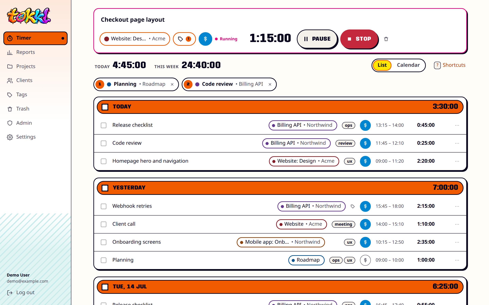
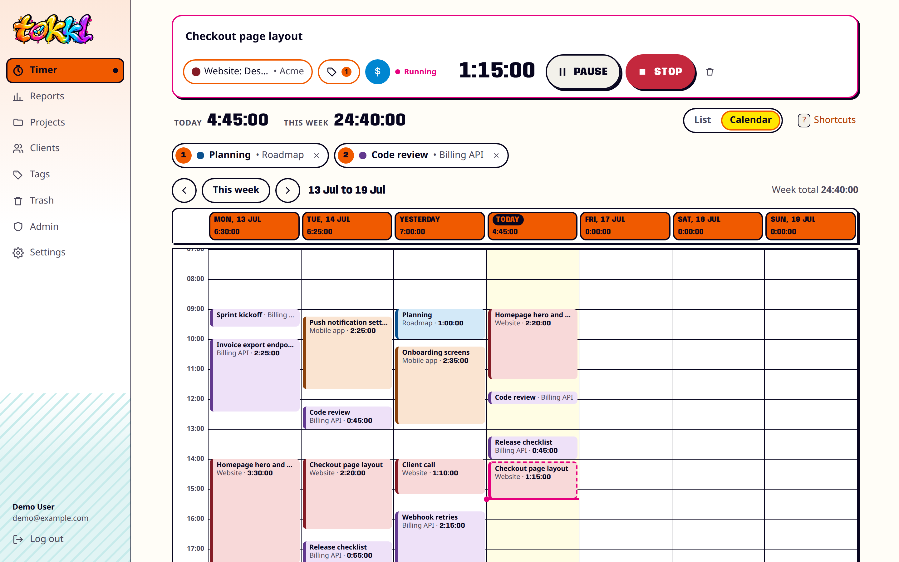
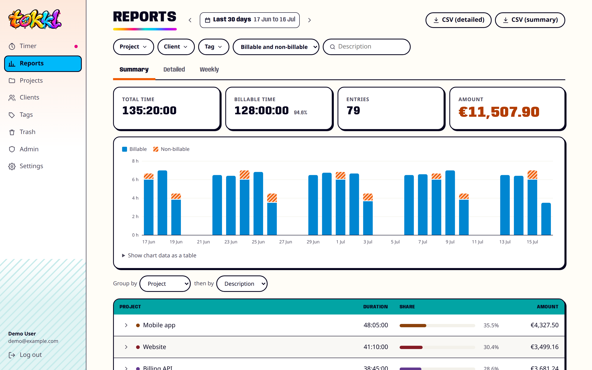
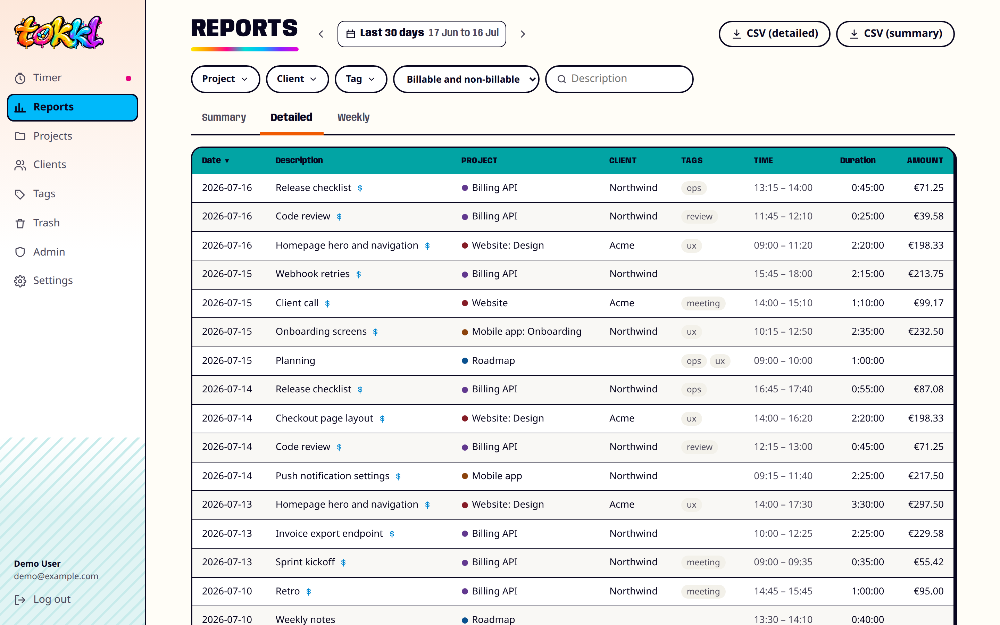
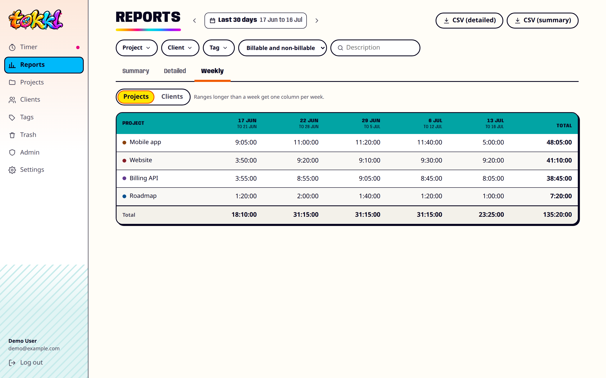
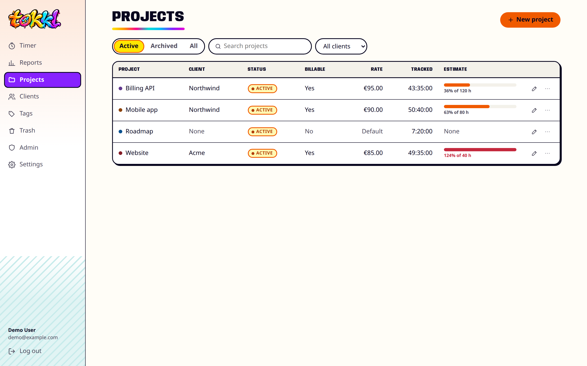
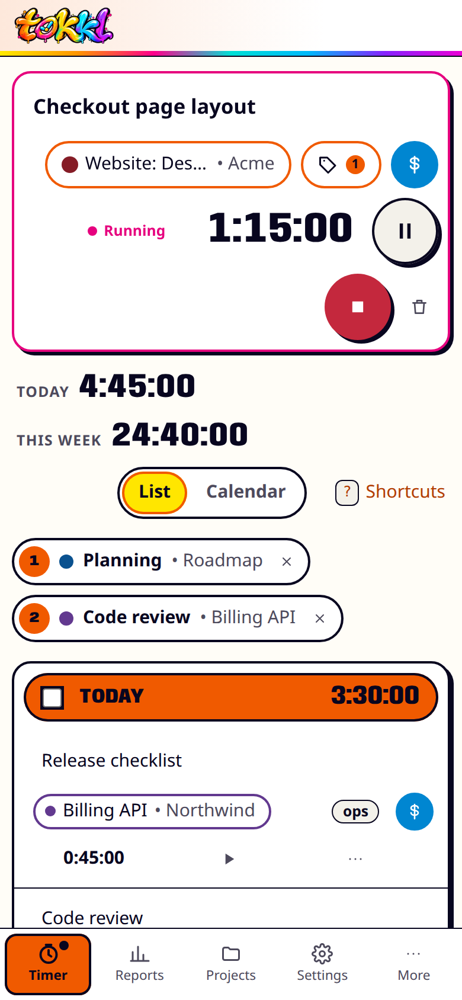
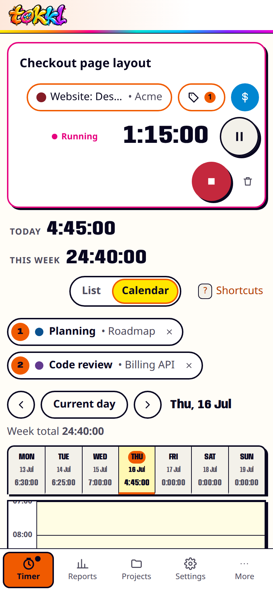
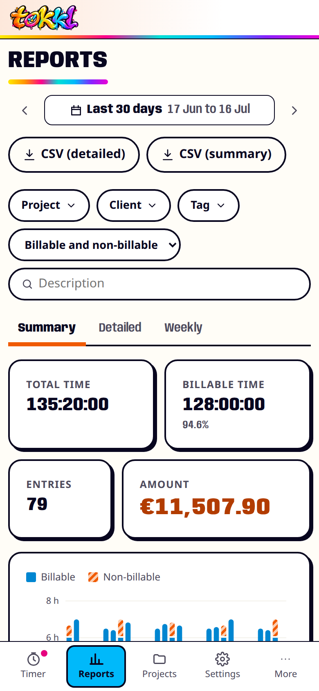
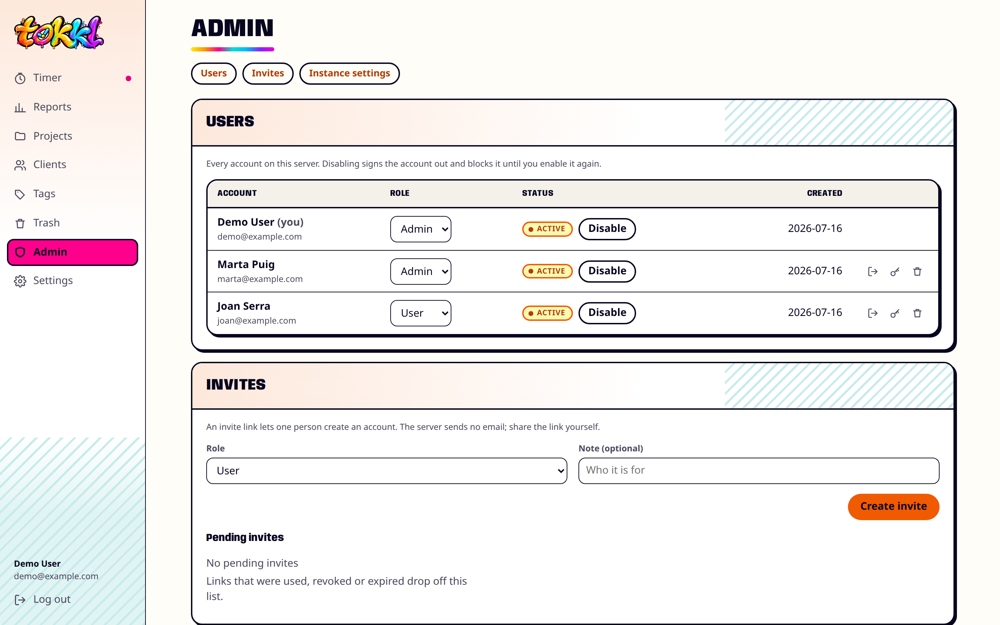

<h1></h1>

A self-hosted time tracker modeled on Toggl Track. One server holds several accounts, and each account has its own private workspace. It runs on a server you own, keeps every entry in one SQLite file, and answers on a subset of the Toggl Track API v9 and Reports API v3. Scripts and libraries using the [supported endpoints and parameters](docs/PRD.md#6-toggl-api-compatibility) can switch to it by changing the base URL. Stopped entries follow Tokkl's instance time resolution, so their stored times can differ from the times sent.

The server makes no outbound requests. No telemetry, CDN fonts or AI features.

Product requirements and feature status are in [docs/PRD.md](docs/PRD.md).

## What it does

- Timer with one running entry, pause and resume, Stop, continue, autocomplete, favorites (`1` to `9`), and Toggl's shortcuts (`N`, `S`, `C`, `M`, `?`).
- A Pomodoro in the web app: work and break countdowns in the timer bar, a long break after every few work phases, a bell and a banner when a phase ends on any page, a browser notification when it ends in a background tab, and an optional pause at the end of each work phase.
- Manual mode that understands `9`, `930`, `9:30`, `4pm`, entries across midnight, and durations like `1h 30m`, `90`, `1,5h`.
- Day-grouped history with no 90-day limit, inline edits, grouping of similar entries, bulk edit, duplicate, split, undo and a trash.
- Projects (colors, clients, rates, estimates, tasks), clients, tags.
- Summary, detailed and weekly reports with filters, billable amounts, rounding, CSV export, and bookmarkable URLs.
- Import of Toggl Track's detailed CSV export (safe to repeat), CSV and JSON export, and restore from the JSON export.
- Works on phones; installable as a PWA.
- A KDE Plasma panel widget, a macOS menu bar app and a GNOME top bar extension start, pause, resume and stop the timer from the desktop: a click pauses a running timer and resumes a paused one, and Stop is in each companion's menu. See [KDE panel companion](#kde-panel-companion), [macOS menu bar companion](#macos-menu-bar-companion) and [GNOME companion](#gnome-companion); the guides are [desktop/kde/README.md](desktop/kde/README.md), [desktop/macos/README.md](desktop/macos/README.md) and [desktop/gnome/README.md](desktop/gnome/README.md).

## Screenshots

The data is synthetic: three clients, five projects and five weeks of weekday entries, with one timer running. One client and one project are archived. `npm run screenshots` regenerates the images from that data, as the [Development](#development) section explains.

**Timer.** The running entry is at the top and history is grouped by day. Favorites are bold numbered pills under the timer, and the sidebar lists Timer, Reports, Projects, Clients, Tags, Trash and Settings, plus Admin for admins.



**Calendar.** A week view in the account's timezone. On screens narrower than 760px it shows one day, with the week's days and their totals in a strip above. There, arrows or a sideways swipe move one day, across weeks. Drag on an empty slot to add an entry, drag a block to move it, or drag its bottom edge to change the end. On a touchscreen, press and hold before dragging. `T` jumps to today in the day view, or to this week in the week view.



**Summary report.** Totals, billable share, amounts, a daily chart and a project breakdown, for any range with filters.



**Detailed and weekly reports.** Every matching entry, sorted and paged on the server, and a project-by-week grid.





**Projects.** Clients, rates, tracked time and estimate progress.



**On a phone.** The same timer, calendar and reports, with a bottom bar for Timer, Reports, Projects, Settings and More.

<p>
  
  
  
</p>

**Admin.** The demo instance has one admin, `demo@example.com`, who owns the data above, and two accounts created from invite links: another admin and a regular user. Admins manage accounts, invites and instance settings here.



## Running

Requires Node.js 24 or newer. The server is one process that serves the API and the web app and keeps its data in one SQLite file.

```sh
npm ci
npm run build
npm start
```

On first start the log prints a setup code:

```
No admin account yet. Open the web UI and use this setup code to create it: ABCD-EFGH-JKLM
```

Open the web app, enter the code, and create the first admin account. Only someone who can read the server log can do that. Later users join through invite links: an admin creates a link on the Admin page, picks the new account's role (admin or user) and shares the link by hand. The server sends no email. A link works once and expires after 7 days unless an admin changes that. Each invited account gets its own private workspace.

The Admin page also changes roles, disables and re-enables accounts, signs them out, deletes them with their workspace, and sets how long new sessions (1 to 365 days) and invite links (1 to 90 days) last. It also sets the time resolution, `time_resolution_minutes`, to any divisor of 60 minutes. The default is 5. Each stopped entry saved after a change snaps to it, and its start moves to the nearest step on the account's clock. A typed or edited entry's duration rounds up to a multiple of the resolution. A timer ends on the step nearest the moment it stops, so when a new timer stops the old one, the two entries are stored back to back. A stopped timer can therefore come out up to a step shorter or longer than the time that passed, and a stop and a new start sent seconds apart can leave a gap of one step. Existing entries change only when they are next edited, and CSV imports and JSON restores keep the times in the file. The server always keeps one active admin. Admins manage accounts only: they have no access to other accounts' workspaces, so they cannot read anyone else's entries.

An admin can also create a one-time password reset link for an account and share it by hand. The link is valid for 24 hours, and a newer link replaces the older unused one. Setting a new password through the link signs the account out of every session and replaces the account's API token. Changing the password under Settings replaces the token too. Apps and scripts that saved the old token must sign in again with the new one, shown under Settings → API token.

All data is in `tokkl.sqlite` (plus its `-wal` and `-shm` files) inside the data folder. Settings → Data also exports everything as JSON and all entries as CSV, and restores the JSON export.

## Running with Docker

Each release publishes `ghcr.io/e0ipso/tokkl` for amd64 and arm64, tagged with the full version (`1.2.3`), `1.2`, `1` and `latest`. The database lives in `/data`; mount a volume there.

```sh
docker run -d --name tokkl -p 8080:8080 -v tokkl-data:/data ghcr.io/e0ipso/tokkl:1
docker logs tokkl    # prints the setup code on first start
```

The container runs as the image's `node` user (UID 1000). To run it as another UID, pass `--user` and mount a directory that UID owns; the app files are read-only, and `/data` is the only place it writes. Pass settings from [Configuration](#configuration) with `-e`. The image sets `TOKKL_DATA_DIR` to `/data`.

For a throwaway database, such as a test run, mount a tmpfs with a mode the `node` user can write to:

```sh
docker run -d --name tokkl-test -p 8080:8080 --tmpfs /data:mode=1777 ghcr.io/e0ipso/tokkl:1
```

A plain `--tmpfs /data` does not work. It replaces the image's `/data` with a directory owned by root, so the server cannot create its database and exits at start. The data is gone when the container stops.

## Configuration

| Variable | Default | Meaning |
|---|---|---|
| `PORT` | `8080` | HTTP port |
| `HOST` | `0.0.0.0` | Bind address |
| `TOKKL_DATA_DIR` | `./data` | Folder for the database |
| `TOKKL_DATABASE` | `<data dir>/tokkl.sqlite` | Database file path |
| `TOKKL_TRUST_PROXY` | `false` | Trust one reverse proxy hop. The client address for login rate limiting then comes from the last `X-Forwarded-For` entry, and `X-Forwarded-Proto: https` makes the session cookie `Secure` and turns on HSTS. Set it only when the app is reachable through the proxy alone. |
| `TOKKL_SESSION_DAYS` | `30` | Default lifetime in days of a new login session. Once an admin saves a session length on the Admin page, that value replaces this one. Existing sessions keep their expiry. |
| `TOKKL_SETUP_CODE` | random | Fixed setup code that creates the first admin, for scripted installs |
| `TOKKL_WEB_ROOT` | `dist/web` | Folder with the built web app |

## Moving from Toggl Track

1. In Toggl Track open Reports → Detailed, pick a date range (a year at a time works well), and export CSV. Set your Toggl duration format to "Improved" first.
2. In Tokkl set your timezone in Settings to the one your Toggl profile uses. Times in the CSV are read in that timezone.
3. Settings → Data → Import from Toggl Track. The preview shows what would be created; then import.

Clients, projects, tasks and tags are created as needed. Rows that match an existing entry are skipped, so overlapping files or a second run do no harm. Project colors and rates are not in Toggl's CSV; set them afterwards on the Projects page.

## Using the Toggl-compatible API

Find your API token under Settings → API token. Authentication is the same as Toggl's. In these examples `$TOKKL_URL` is wherever the server is reachable. Each account has its own workspace, so read its id from `default_workspace_id` in `GET /api/v9/me` first (this uses `jq`):

```sh
WID=$(curl -s -u "$TOKEN:api_token" $TOKKL_URL/api/v9/me | jq -r .default_workspace_id)

curl -u "$TOKEN:api_token" $TOKKL_URL/api/v9/me
curl -u "$TOKEN:api_token" $TOKKL_URL/api/v9/me/time_entries/current

# Start a timer
curl -u "$TOKEN:api_token" -H 'Content-Type: application/json' \
  -d '{"description":"Deep work","start":"'"$(date -u +%FT%TZ)"'","duration":-1,"created_with":"curl","workspace_id":'"$WID"'}' \
  $TOKKL_URL/api/v9/workspaces/$WID/time_entries

# Summary report
curl -u "$TOKEN:api_token" -H 'Content-Type: application/json' \
  -d '{"start_date":"2026-10-01","end_date":"2026-10-31","grouping":"projects","sub_grouping":"time_entries"}' \
  $TOKKL_URL/reports/api/v3/workspace/$WID/summary/time_entries
```

Most Toggl apps hardcode `api.track.toggl.com` and cannot be redirected (Raycast, Obsidian, `toggl-cli`, Timery, Toggl's own apps). Libraries that accept a base URL work, for example `toggl-client` (`TOGGL_BASE_URL`), `toggl-track` (`baseURL`), `toggl-api` (`apiUrl`) and `toggl_python` (`base_url`). The PRD lists implemented endpoints and the behavior decisions in [section 6](docs/PRD.md#6-toggl-api-compatibility).

## KDE panel companion

A Plasma 6 panel widget for Debian 13 (amd64) and Fedora KDE 44 (x86_64). It shows the running timer in the panel, starts, pauses and resumes it with a click, stops it from its menu, and sets the project and billable flag. It signs in to one account with the API token, or an email and password, and keeps the secret in KDE Wallet. It talks only to your server and sees only that account's workspace.

It ships as a DEB and an RPM attached to each GitHub release that includes it, under the same version as the server and the Docker image. The Docker image does not contain it. As of 2026-10-16 no release has carried the packages; the guide says how to build them. The packages are under the MIT license, like the rest of Tokkl. Installation, setup, behavior, the build and a manual Plasma checklist are in [desktop/kde/README.md](desktop/kde/README.md).

## macOS menu bar companion

A menu bar app for Macs with Apple silicon and macOS 13 or later. It shows the running timer's time in the menu bar, starts, pauses and resumes it with a click, stops it from its menu, and sets the project and billable flag. It keeps the API token or password in the macOS Keychain.

It ships as `Tokkl-<version>-arm64.dmg`, attached to each GitHub release that includes it, under the same version as the server and the Docker image. It is signed ad hoc, not with an Apple Developer ID, and is not notarized, so remove the quarantine flag after you drag it to `/Applications`:

```sh
xattr -cr /Applications/Tokkl.app
```

Installation, setup and the build are in [desktop/macos/README.md](desktop/macos/README.md).

## GNOME companion

A GNOME Shell extension for GNOME Shell 46 to 51 and `tokkl-timerd`, the session service it drives. The top bar button shows the running timer, pauses and resumes it with a click, stops it from its menu, and sets the project and billable flag. The service keeps the API token or password in the keyring.

It ships as a DEB of `tokkl-timerd` for Debian 13 (amd64), an RPM for Fedora 44 (x86_64) and `tokkl-gnome-extension-<version>.zip`, attached to each GitHub release that includes them, under the same version as the server and the Docker image. v1.2.0 was the first release with them; its DEB was built for Ubuntu 26.04 LTS, and the next release brings the Debian 13 build. Installation, setup and the build are in [desktop/gnome/README.md](desktop/gnome/README.md).

## Development

Requires Node.js 24 or newer.

```sh
npm install
npm run dev        # API server on :8080, restarts on change
npm run dev:web    # Vite dev server on :5173, proxies /api and /reports to :8080
npm test           # unit and API tests (node --test)
npm run typecheck  # tsc over every package, e2e, scripts, bench and the KDE tests
npm run build      # builds the web app into dist/web
npm run test:e2e   # builds, then runs the Playwright browser tests
npm run screenshots  # builds, then rewrites docs/screenshots/*.png
npm run check:tracker-refs  # fails when a tracked file cites a ticket ID or plan path
npm run icons      # derives the served icons from docs/brand/icon-pack and the wordmarks from docs/brand/wordmark-pack (needs ImageMagick 7)
```

Other clients take their brand assets from [docs/brand](docs/brand/README.md): the wordmark, including a full-width crop for use larger than 640 px, and the icon pack with web, Android launcher and store icons.

The KDE companion is a separate CMake project that no npm script builds. To build and test it, run `cmake -S desktop/kde -B desktop/kde/build`, `cmake --build desktop/kde/build` and `ctest --test-dir desktop/kde/build` (needs Qt 6.8, KDE Frameworks 6.13 and Plasma 6.3; [details](desktop/kde/README.md#configure-build-and-test)). It builds on `desktop/core`, the timer and connection core the desktop companions share. That project needs only Qt 6.8 Core, Network and Test, and the same three commands pointed at `desktop/core` build and test it on its own.

Commit messages follow [Conventional Commits](https://www.conventionalcommits.org/). `npm install` sets up a commit-msg hook that runs commitlint, and CI lints every PR's commits and every push to main. Commits that credit an AI tool or a co-author (`Co-authored-by:`, "Generated with Claude Code" and the like) are rejected. Every push to main runs the checks, the KDE companion's included, and then semantic-release. `feat`, `fix`, `perf`, `refactor` and `revert` commits cut a release (a breaking change cuts a major one): a version bump, a changelog entry, a GitHub release with the KDE companion's DEB and RPM attached (see [desktop/kde/README.md](desktop/kde/README.md#ci-and-releases)), the macOS companion's DMG, which a later job attaches to the same release (see [desktop/macos/README.md](desktop/macos/README.md#releases)), the GNOME companion's DEB, RPM and extension zip, also attached by later jobs (see [desktop/gnome/README.md](desktop/gnome/README.md#releases)), and a container image. `docs`, `build`, `ci`, `test`, `style` and `chore` commits do not.

The repo is an npm workspaces monorepo. Run every script from the repo root. The server runs TypeScript directly through Node's type stripping, so only the web app has a build step. Layout:

```
packages/api     @tokkl/api: Express app, Toggl v9 and Reports v3 routes, SQLite models, import/export (src/, test/)
packages/web     @tokkl/web: React app, built by Vite into dist/web
packages/common  @tokkl/common: duration, time-of-day and timezone helpers used by the API and the web app
packages/types   @tokkl/types: type declarations for the JSON the API and the web app exchange
e2e/             Playwright tests
desktop/core/    Shared desktop core: API client, connection state and timer controller, Qt only (its own CMake project)
desktop/kde/     KDE Plasma panel companion: widget, Qt backend, DEB and RPM packaging, CI images and tests (its own CMake project)
scripts/         README screenshot generator and the icon and wordmark generator for the docs/brand packs
bench/           history-scale measurements
docs/            PRD.md (product requirements), brand/ and screenshots/
```

## License

MIT. See [LICENSE](LICENSE).
