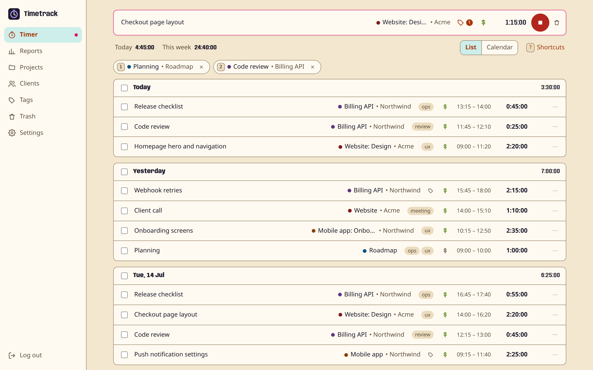
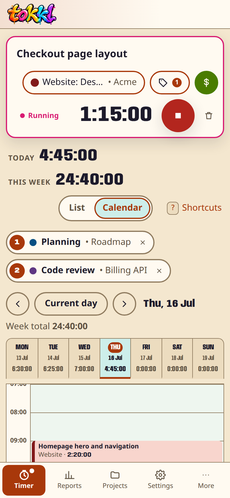

<h1></h1>

A self-hosted time tracker modeled on Toggl Track, with private workspaces for each account and a choice of SQLite, PostgreSQL, MySQL or MariaDB. One server serves the web app and a subset of Toggl Track API v9 and Reports API v3, with no telemetry or third-party web assets. Optional SMTP sends sign-up verification emails.

## What it does

- Timer, pause/resume, favorites, shortcuts and Pomodoro sessions.
- Manual entries, history, calendar, bulk edits and trash.
- Projects, clients, tasks and tags; summary, detailed and weekly reports with billable amounts.
- Repeat-safe Toggl CSV import, CSV export and JSON backup/restore.
- Mobile PWA; KDE, macOS and GNOME companions.





## Get started

| Goal | Guide |
| --- | --- |
| Run Tokkl with Docker or Node.js | [Installation options](docs/hosting/README.md) |
| Deploy on a VPS without Docker | [Node, systemd and nginx](docs/hosting/native-vps.md) |
| Update an existing native VPS installation | [VPS updater](docs/hosting/vps-updates.md) |
| Use an instance someone has already installed | [Accounts, time settings and clients](docs/using-tokkl.md) |

For a quick Docker start with a persistent data volume:

```sh
docker run -d --name tokkl -p 8080:8080 -v tokkl-data:/data ghcr.io/e0ipso/tokkl:latest
docker logs tokkl    # first-admin setup code
```

Open `http://localhost:8080` and create the first administrator with the setup
code from the log. Each account has its own private workspace. See
[hosting](docs/hosting/README.md) for image tags, storage permissions and other
installation methods.

## Documentation

The [documentation index](docs/README.md) links to all guides by task:

- [Using Tokkl](docs/using-tokkl.md), [importing and exporting data](docs/data.md)
  and [connecting API clients](docs/api.md).
- [Server configuration](docs/hosting/configuration.md),
  [database selection](docs/hosting/databases.md) and
  [server operations](docs/hosting/operations.md).
- [Development and testing](docs/development.md). Run `npm run check:tracker-refs`
  before committing to keep ticket and plan references out of source files and
  documentation.

Desktop companions ship separately on
[GitHub releases](https://github.com/e0ipso/tokkl/releases):
[KDE Plasma](desktop/kde/README.md), [macOS](desktop/macos/README.md) and
[GNOME](desktop/gnome/README.md).

[MIT license](LICENSE).
